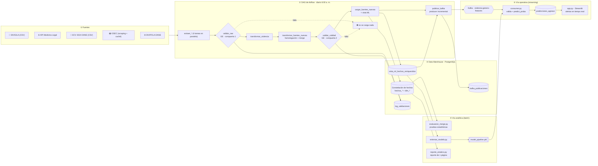
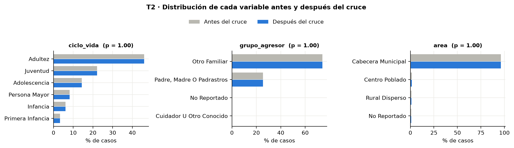
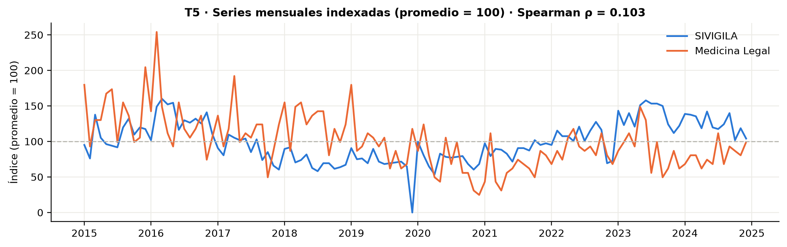
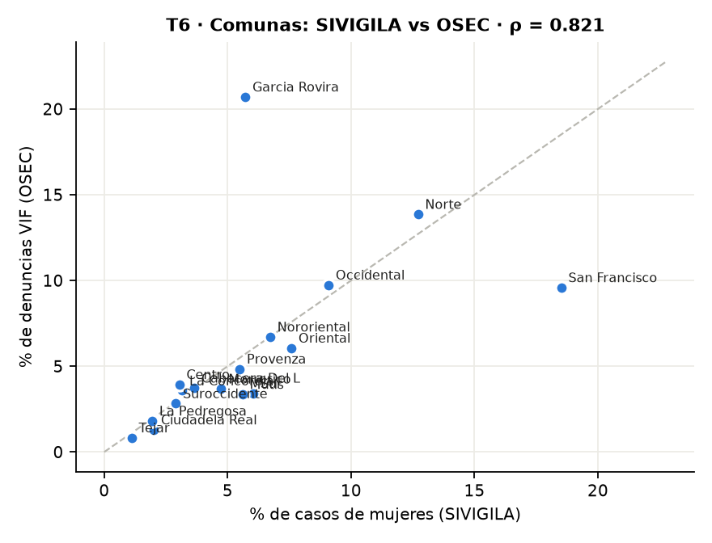
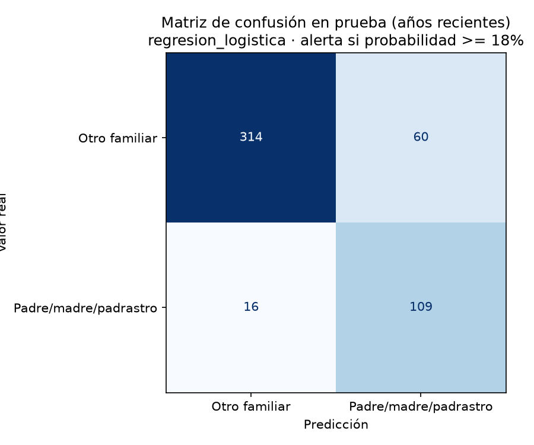

<div align="center">

# Documento técnico · Entrega final
## Violencia contra las mujeres en Bucaramanga: una arquitectura de datos analítica y operativa

**Curso:** ETL (G51) · Ingeniería de Datos e Inteligencia Artificial
**Fecha:** 23 de noviembre de 2026 · **ODS 5:** Igualdad de género (meta 5.2)

**Equipo:** Leidy Johanna Alomia Zapata · Gustavo Coque · Carlos Cortes

</div>

---

## Contenido

1. [Resumen ejecutivo](#1-resumen-ejecutivo)
2. [Equipo y distribución del trabajo](#2-equipo-y-distribución-del-trabajo)
3. [Objetivo y pregunta del proyecto](#3-objetivo-y-pregunta-del-proyecto)
4. [Fuentes de datos y cómo se combinan](#4-fuentes-de-datos-y-cómo-se-combinan)
5. [Diagrama de arquitectura actualizado](#5-diagrama-de-arquitectura-actualizado)
6. [Pasos del pipeline ETL](#6-pasos-del-pipeline-etl)
7. [Diseño del DAG de Airflow](#7-diseño-del-dag-de-airflow)
8. [Transformaciones de datos](#8-transformaciones-de-datos)
9. [Calidad de datos: doble compuerta con Great Expectations](#9-calidad-de-datos-doble-compuerta-con-great-expectations)
10. [Modelo dimensional](#10-modelo-dimensional)
11. [Evaluación estadística del merge](#11-evaluación-estadística-del-merge)
12. [Modelo de machine learning](#12-modelo-de-machine-learning)
13. [Streaming con Kafka: productor, tópico y consumidor](#13-streaming-con-kafka-productor-tópico-y-consumidor)
14. [Reporte analítico estático](#14-reporte-analítico-estático)
15. [Dashboard de predicciones en tiempo real](#15-dashboard-de-predicciones-en-tiempo-real)
16. [Generación de valor: proceso analítico y proceso operativo](#16-generación-de-valor-proceso-analítico-y-proceso-operativo)
17. [Supuestos y limitaciones](#17-supuestos-y-limitaciones)
18. [Trabajo futuro](#18-trabajo-futuro)
19. [Reproducibilidad](#19-reproducibilidad)

---

## 1. Resumen ejecutivo

Esta entrega extiende el pipeline de la segunda entrega sin reemplazarlo: conserva las fuentes, el DAG de Airflow, la validación con Great Expectations y el modelo dimensional en PostgreSQL, y agrega **dos vías de consumo** sobre la misma arquitectura:

| Vía | Para qué | Cómo |
|---|---|---|
| **Analítica (batch)** | Entender el fenómeno y tomar decisiones estratégicas | Modelo dimensional validado → **reporte estático de una página** con preguntas, hallazgos y recomendaciones |
| **Operativa (streaming)** | Priorizar cada caso nuevo apenas llega | Modelo dimensional → **Kafka** → consumidor con el **modelo de ML serializado** → **dashboard Streamlit** en tiempo real |

**Resultados principales**

- El DAG ejecuta **10 tareas** en verde, con una **doble compuerta de calidad** (antes y después de transformar) de **10 suites y 120 expectativas**.
- El **modelo de ML** predice si el agresor de una víctima es **padre, madre o padrastro** frente a **otro familiar**. Alcanza **ROC-AUC 0.92** en años que nunca vio (2022–2024), contra 0.50 de la línea base, y no memoriza: la brecha entre entrenamiento y prueba es ≈ 0.
- El **productor de Kafka es incremental**: publica cada caso nuevo **una sola vez**. El consumidor aplica el modelo y el dashboard muestra prioridades, acciones sugeridas y un mapa con los límites oficiales del DANE.
- La **evaluación estadística del merge** (corrección de la entrega anterior) demuestra que el cruce **no sesga los datos** (χ² p = 1 en todas las variables) y justifica con datos por qué las fuentes **se comparan y no se suman**.

---

## 2. Equipo y distribución del trabajo

El trabajo se dividió en tres frentes que se integran en una sola arquitectura:

| Integrante | Rol | Responsabilidades y entregables |
|---|---|---|
| **Leidy Johanna Alomia Zapata** | Data Engineer · ETL y orquestación | DAG `etl_violencia_genero_bucaramanga` (10 tareas); respaldo en caché del scraping del OSEC (*fallback cache*) para que el pipeline sea reproducible si el portal no responde; doble compuerta de Great Expectations (`validar_raw` y `validar_calidad`) con registro en `log_validaciones`; limpieza de años inválidos (sin imputar 0) y carga idempotente; columnas del Data Warehouse y vista `vista_ml_hechos_enriquecidos` (creada por el DAG, sin valores imputados); estabilización de Docker/WSL y Kafka (`docker-compose.kafka.yml`); productor de Kafka inicial con la regla anti-fuga de datos |
| **Gustavo Coque** | Data Scientist · ML Engineer | Evaluación estadística del merge (`analisis/evaluacion_merge.py`, corrección del profesor); definición del problema de predicción, entrenamiento, evaluación y serialización del modelo (`ml/entrenar_modelo.py`, `models/`); consumidor de Kafka con validación del mensaje, inferencia y tabla de predicciones (`consumer.py`); evolución del productor a **incremental** con tabla de control (`etl/producer.py`) |
| **Carlos Cortes** | Analytics · Visualización y documentación | Reporte analítico estático de una página (`reporte_estatico.py`); dashboard de predicciones en tiempo real en Streamlit (`app.py`), con mapa de zonas del DANE (`etl/descargar_zonas_dane.py`), prioridades y monitor del flujo; documento técnico, README y cierre del repositorio |

---

## 3. Objetivo y pregunta del proyecto

**Objetivo.** Demostrar cómo una sola arquitectura de datos soporta al mismo tiempo **decisiones analíticas** (¿dónde y cómo ocurre la violencia?) y un **flujo operativo de predicción** (¿qué caso atender primero?).

**Pregunta del proyecto.** ¿Cómo se manifiesta la violencia contra las mujeres en Bucaramanga según el vínculo con el agresor, el ciclo de vida de la víctima, el tipo de violencia, la comuna y el contexto socioeconómico, y qué aportan las fuentes complementarias a esa caracterización?

**Pregunta del modelo de ML.** Dado un caso de lesiones por violencia intrafamiliar contra una mujer, ¿qué tan probable es que el agresor sea **padre, madre o padrastro**? Si la víctima es menor de edad, eso exige activar la ruta de protección (ICBF / Comisaría de Familia).

---

## 4. Fuentes de datos y cómo se combinan

| # | Fuente | Tipo | Rol en el proyecto | Periodo |
|---|---|---|---|---|
| 1 | **SIVIGILA**, histórico de violencia de Bucaramanga (fuente de la primera entrega) | CSV | Casos individuales atendidos en salud: vínculo con el agresor, tipo de violencia, ciclo de vida y comuna | 2015–2025 |
| 2 | **ECV 2024, DANE** (dataset adicional de la segunda entrega) | CSV | Contexto socioeconómico: estrato, tipo y zona de las viviendas de Bucaramanga | 2024 (foto estacionaria) |
| 3 | **API Medicina Legal**, datos.gov.co `ers2-kerr` (API pública) | API | Casos de lesiones no fatales por violencia intrafamiliar, valorados por Medicina Legal. **Es la fuente del modelo de ML y del flujo de Kafka** | 2015–2024 |
| 4 | **OSEC**, boletines de la Alcaldía de Bucaramanga | Web scraping (PDF) | Denuncias de violencia intrafamiliar y delitos sexuales **por comuna** | 2024–2026 |
| 5 | **DIVIPOLA, DANE** | API (catálogo) | Código DANE y coordenadas de los municipios | Vigente |

**Cómo se vinculan.** Las fuentes no comparten un identificador de caso. Se integran por **lugar** (código DANE, área y comuna) y por **tiempo** (año y mes), después de homologar los valores. Las fuentes **se comparan, no se suman**: cada una cuenta algo distinto (atención en salud, valoración forense, denuncia, vivienda). La sección 11 lo demuestra estadísticamente.

**Fuente no disponible.** Durante esta entrega el portal `www.bucaramanga.gov.co` rechazó conexiones (`ConnectionRefusedError`). La extracción del OSEC usa entonces un **respaldo automático en caché** (`data/cache_scraping_boletines.csv` y `data/cache_scraping_comunas.csv`), que conserva la misma estructura y lógica. Así el pipeline sigue siendo reproducible sin depender de la disponibilidad del portal.

---

## 5. Diagrama de arquitectura actualizado



**Lectura del diagrama.** Todo nace del mismo Data Warehouse validado. La vía **batch** lo consulta para analizar y entrenar. La vía **streaming** publica cada caso nuevo en Kafka; el consumidor usa el modelo entrenado en batch (se carga una sola vez) y el dashboard se alimenta **solo** de lo que produce el consumidor.

---

## 6. Pasos del pipeline ETL

| Paso | Qué ocurre | Archivo |
|---|---|---|
| 1. Extracción | Las 4 fuentes se extraen en paralelo a la **zona cruda** (texto, sin filtrar, con fuente y fecha de carga). El OSEC es incremental y usa el respaldo en caché si el portal falla | `etl/ingesta.py`, `etl/extraer_scraping.py` |
| 2. Compuerta 1 | Great Expectations valida las tablas crudas **antes de transformar**: esquemas, columnas y años válidos. Si falla, no se gasta cómputo en transformar datos rotos | `etl/validacion.py` (`validar_raw`) |
| 3. Transformación | Modelo estrella de SIVIGILA; limpieza, homologación y merge de las fuentes nuevas en **staging** (`stg_*`) | `etl/transformacion.py`, `etl/transformacion_entrega2.py`, `etl/homologacion.py` |
| 4. Compuerta 2 | Great Expectations valida staging **antes de cargar** | `etl/validacion.py` (`validar_calidad`) |
| 5. Carga | Staging → modelo final en una transacción, con control de que ninguna fila quede sin cargar; se crea la vista para ML | `sql/cargar_entrega2.sql`, `sql/esquema_entrega2.sql` |
| 6. Publicación | El productor envía a Kafka **solo los casos nuevos** | `etl/producer.py` |

---

## 7. Diseño del DAG de Airflow

DAG `etl_violencia_genero_bucaramanga` (`dags/dag_violencia_genero.py`), Apache Airflow 3.3.2 con CeleryExecutor en Docker.

```
extraer_sivigila ─┐
extraer_api ──────┤
extraer_vivienda ─┼─> validar_raw ─> transformar_violencia ─> transformar_fuentes_nuevas
extraer_scraping ─┘                                                    │
                                                                       v
                        publicar_kafka <─ cargar_fuentes_nuevas <─ validar_calidad
```

| # | Tarea | Qué hace |
|---|---|---|
| 1–4 | `extraer_sivigila`, `extraer_api`, `extraer_vivienda`, `extraer_scraping` | Extracción en paralelo a las tablas `raw_*` |
| 5 | `validar_raw` | Compuerta de calidad 1 sobre los datos crudos |
| 6 | `transformar_violencia` | Modelo estrella de SIVIGILA (fuente de la primera entrega) |
| 7 | `transformar_fuentes_nuevas` | API, OSEC, ECV y DIVIPOLA → `stg_*` y dataset unificado |
| 8 | `validar_calidad` | Compuerta de calidad 2 sobre staging |
| 9 | `cargar_fuentes_nuevas` | Staging → modelo dimensional y vista de ML |
| 10 | `publicar_kafka` | Productor incremental hacia el tópico |


| Parámetro | Valor | Por qué |
|---|---|---|
| `schedule` | `0 6 * * *` | Diario a las 6:00 a. m.: recoge casos nuevos de la API y boletines nuevos del OSEC |
| `catchup` | `False` | No ejecuta días pasados |
| `max_active_runs` | `1` | Dos ejecuciones nunca escriben al mismo tiempo en las mismas tablas |
| `retries` | `2` (5 min) | Recupera fallas temporales de red |
| `retries` en las validaciones | `0` | Un error de calidad no se arregla reintentando |

**Ejecuciones repetidas (idempotencia).** La API se recarga por alcance en la zona cruda (llave única `(id, alcance)`). La carga final pasa por staging en una transacción, y las llaves únicas (por ejemplo `id_caso_api`) impiden duplicar casos. El productor tiene su propia tabla de control (sección 13), así que volver a ejecutar el DAG **no duplica** eventos en Kafka.

---

## 8. Transformaciones de datos

| Problema encontrado (EDA) | Transformación |
|---|---|
| La falta de dato viene escrita de muchas formas ("Sin información", "No aplica", vacío) | Se unifica en `NO REPORTADO` |
| Textos con tildes y mayúsculas mezcladas | Normalización: mayúsculas, sin tildes y sin espacios dobles |
| Categorías con nombres distintos entre fuentes | Homologación a un vocabulario común (`etl/homologacion.py`), por ejemplo agresor → 6 grupos y ciclo de vida → 6 etapas |
| Hora en formatos distintos | Conversión a turno (mañana, tarde, noche, no reportado) |
| Comuna escrita de varias formas | Unión por **número** de comuna (1–17), no por nombre |
| Años inválidos | **Se descartan o se marcan como desconocidos; no se imputa 0** (corrección de la entrega anterior) |
| Cifras con formato colombiano ("1.128") | Conversión numérica correcta |
| Estratos 0, 8 y 9 en la ECV | Solo se cargan estratos 1–6 |
| Vacíos en la vista de ML (OSEC, estrato) | Se dejan como `NULL` ("sin dato"); **no se inventan valores** |
| Enfoque del proyecto | Bucaramanga (68001) y víctimas mujeres; la zona cruda conserva todo |

---

## 9. Calidad de datos: doble compuerta con Great Expectations

Se usa **Great Expectations 1.24.0** en **dos puntos** del DAG:

| Compuerta | Tarea | Qué protege | Suites |
|---|---|---|---|
| **1 · Antes de transformar** | `validar_raw` | Que no se procesen esquemas rotos ni años inválidos | `raw_suite_api` (17), `raw_suite_sivigila` (11), `raw_suite_vivienda` (10), `raw_suite_scraping_boletines` (8), `raw_suite_scraping_comunas` (12) |
| **2 · Antes de cargar** | `validar_calidad` | Que solo datos válidos lleguen a las tablas analíticas | `suite_hechos_api` (18), `suite_hechos_osec` (14), `suite_hechos_analisis` (11), `suite_codigo_dane` (3), `suite_dataset_unificado` (16) |
| **Total** | | | **10 suites · 120 expectativas** |

- **Registro:** cada expectativa evaluada queda en la tabla `log_validaciones` (fecha, suite, columna, resultado, filas inesperadas y ejemplos) y en `data/validaciones/*.json`.
- **Bloqueo:** si una expectativa crítica falla, la tarea termina en error y las siguientes quedan en `upstream_failed`. **No se carga nada** y el modelo conserva los datos validados de la ejecución anterior.
- **Última ejecución:** 100 % de expectativas cumplidas (se ve en el panel de calidad del reporte estático).

---

## 10. Modelo dimensional

**Constelación de hechos** (esquema galaxia) en PostgreSQL. Cuatro tablas de hechos comparten dimensiones de lugar y tiempo:

| Tabla de hechos | Grano (una fila =) | Dimensiones |
|---|---|---|
| `hechos_violencia` | Un caso de SIVIGILA | `dim_tiempo`, `dim_municipio`, `dim_victima`, `dim_agresor`, `dim_tipo_violencia`, `dim_comuna` |
| **`hechos_api_violencia`** | **Un caso de lesión no fatal por violencia intrafamiliar contra una mujer en Bucaramanga, valorado por Medicina Legal** | `dim_tiempo`, `dim_municipio` |
| `hechos_osec_comuna` | Denuncias de un delito en una comuna en un mes | `dim_tiempo`, `dim_comuna` |
| `hechos_analisis` | Una vivienda de la ECV 2024 | `dim_municipio`, `dim_estrato` |

Además: `dataset_unificado` (una fila por año-mes, con una columna por fuente) y `vista_comuna_anual`.

**Medida que se publica en Kafka.** Cada evento es **un caso de `hechos_api_violencia`** con las características del hecho que se conocen **sin saber quién fue el agresor** (escenario, ciclo de vida, turno, días de incapacidad, área, mes), más su identificador. La vista `vista_ml_hechos_enriquecidos` arma ese registro uniendo la tabla de hechos con sus dimensiones y el contexto cruzado (OSEC, ECV). La medida que agrega el flujo operativo es la **probabilidad de que el agresor sea padre, madre o padrastro**, que calcula el consumidor.

---

## 11. Evaluación estadística del merge

**Corrección de la entrega anterior:** demostrar que unir fuentes de **serie de tiempo** (SIVIGILA, Medicina Legal, OSEC) con una fuente **estacionaria** (ECV 2024) es válido y no sesga los datos.

Script: [`analisis/evaluacion_merge.py`](../analisis/evaluacion_merge.py). Resultados: [`Docs/evaluacion_merge/evaluacion_merge.md`](evaluacion_merge/evaluacion_merge.md).

| Prueba | Método | Resultado | Conclusión |
|---|---|---|---|
| T1 Conservación de registros | Conteo, duplicados y faltantes | 1,936 → 1,936; 0 duplicados; 0 faltantes | ✅ El cruce no pierde ni duplica casos |
| T2 Distribuciones antes vs. después | χ² de homogeneidad y distancia de variación total | p = 1.0 en las 7 variables; distancia = 0 | ✅ **El cruce no sesga los datos** |
| T3 Series del dataset unificado | Diferencia mes a mes contra cada fuente | 0 en 129 y 120 meses | ✅ Las series se conservan exactas |
| T4 Fuente estacionaria | Variación de la ECV en el tiempo | Un solo valor en todo el periodo | ✅ No crea tendencias ni estacionalidad falsas |
| T5 Concordancia temporal | Spearman mensual y anual | SIVIGILA vs. Medicina Legal ρ = 0.10 (p = 0.26) | Las series **no se mueven juntas** |
| T6 Concordancia territorial | Spearman por comuna | ρ = 0.82 (p < 0.001); mismo periodo del OSEC: ρ = 0.77 (p < 0.001) | Las comunas **sí concuerdan** entre fuentes |
| T7 Sesgo por cobertura del OSEC | χ² y V de Cramér | V = 0.04 (p = 0.33) | ✅ Los casos con y sin dato del OSEC no difieren |
| T8 Aporte al objetivo del modelo | V de Cramér | Ciclo de vida 0.69; estrato, zona y OSEC ≤ 0.055 | Las variables cruzadas se usan en el análisis, no en el modelo |







**Interpretación.**
1. El merge es **neutro**: no cambia el número de casos, su distribución ni las series (T1–T3).
2. La ECV es una foto de 2024 y se trata como **contexto**, no como variable temporal (T4).
3. **T5 valida el diseño:** SIVIGILA y Medicina Legal no correlacionan en el tiempo porque reflejan procesos institucionales distintos. Sumarlas habría mezclado procesos; por eso el dataset unificado tiene **una columna por fuente**. En el territorio sí concuerdan (T6), así que **comparar comunas entre fuentes es válido**.
4. **T7 y T8 justifican con datos** por qué el modelo usa las variables propias del caso y no las cruzadas.

---

## 12. Modelo de machine learning

### 12.1 Problema y objetivo
- **Variable objetivo:** `grupo_agresor` en binario. **1** = padre, madre o padrastro; **0** = otro familiar.
- **Datos:** `vista_ml_hechos_enriquecidos`. Son 1,936 casos; se usan 1,928, porque se excluyen 8 de "cuidador" y "no reportado" (muy pocos para aprender).
- **Por qué predecirlo:** si la víctima es menor y el agresor probable es su padre o madre, hay que activar la ruta de protección. El modelo **prioriza** casos para revisión; **no identifica ni acusa a ninguna persona**.

### 12.2 Características
| Usadas | Excluidas y por qué |
|---|---|
| `escenario`, `ciclo_vida`, `turno`, `dias_incapacidad`, `area`, `mes` | `grupo_agresor`, `presunto_agresor`, `sexo_agresor`, `edad_agre`, `parentesco_vict`: **fuga de datos** (describen la respuesta) |
| | `anio`, `id_hecho_api`: un año nuevo nunca se ha visto y un id no generaliza |
| | `nombre_municipio`: es constante (siempre Bucaramanga) |
| | `contexto`, `tipo_violencia`: repiten la edad de la víctima. El experimento con y sin ellas dio ROC-AUC 0.920 vs. 0.917: no aportan |
| | `osec_*`, `nivel_estrato`, `zona_vivienda`: casi sin señal para el caso individual (sección 11, T8) |

### 12.3 Preprocesamiento (dentro del pipeline serializado)
- **Faltantes:** las categorías vacías pasan a `NO REPORTADO`; el mes vacío toma el valor más frecuente.
- **Categóricas:** `OneHotEncoder` con `min_frequency=10`, que agrupa las categorías raras para no sobreajustar, y `handle_unknown="infrequent_if_exist"`, para que una categoría nueva que llegue por Kafka no rompa el modelo.
- Todo va en **un solo `Pipeline` de scikit-learn**, así el consumidor aplica exactamente las mismas transformaciones.

### 12.4 Entrenamiento y evaluación
| Decisión | Valor | Por qué |
|---|---|---|
| División | **Temporal**: entrenamiento 2015–2021 (1,429 casos), prueba 2022–2024 (499) | Simula recibir casos del futuro; evita fuga temporal |
| Selección de hiperparámetros | `GridSearchCV` con 5 particiones, **solo en entrenamiento** | La prueba se usa una sola vez al final |
| Modelos | Línea base (clase más frecuente), regresión logística y random forest | Comparar contra un modelo "tonto" |
| Desbalance | Sin `class_weight`, con **umbral de alerta** | Probabilidades reales (calibradas) en el dashboard |
| Umbral de alerta | **0.184**: el más alto con recall ≥ 90 % en predicciones fuera de muestra del entrenamiento | Se prefiere una falsa alarma a dejar un menor sin protección |
| Modelo desplegado | Regresión logística (C = 1.0), elegida por validación cruzada y reentrenada con todos los datos | Mejor en validación cruzada, simple y explicable |

### 12.5 Resultados (prueba = años no vistos)
| Modelo | ROC-AUC CV | ROC-AUC entrenamiento | ROC-AUC prueba | Brecha |
|---|---|---|---|---|
| Línea base | 0.50 | 0.50 | 0.50 | 0.00 |
| **Regresión logística** | **0.902** | **0.912** | **0.917** | **−0.005** |
| Random forest | 0.898 | 0.909 | 0.912 | −0.003 |

Con el umbral de alerta, en 2022–2024:

| Métrica | Valor | En palabras |
|---|---|---|
| Recall (padre/madre) | **0.87** | Detecta casi 9 de cada 10 casos donde el agresor es padre, madre o padrastro |
| Precisión (padre/madre) | 0.64 | De cada 10 alertas, unas 6 son correctas |
| Exactitud | 0.85 | Acierta 85 de cada 100 casos |
| Calibración | 22.3 % predicho vs. 25.1 % real | Las probabilidades del dashboard son realistas |

**Matriz de confusión:** de 125 casos reales de padre o madre detecta ≈ 109; de 374 casos de otro familiar genera ≈ 60 falsas alarmas.



### 12.6 Artefactos serializados
| Archivo | Contenido |
|---|---|
| `models/model_pipeline.pkl` | Pipeline completo (preprocesamiento + modelo) con joblib |
| `models/metadata_modelo.json` | Features, clases, umbral, división, métricas y versión de scikit-learn (1.9.1) |
| `models/metricas_experimentos.csv` | Comparación de todos los modelos y experimentos |

Regenerar: `python ml/entrenar_modelo.py`.

### 12.7 Limitaciones
- **El modelo se apoya sobre todo en la edad de la víctima** (V de Cramér 0.69). En menores, el agresor suele ser padre o madre (77 % vs. 10 % en adultas). Es una señal real, pero el modelo aporta poco más allá de ella.
- **Alcance:** solo lesiones físicas por violencia intrafamiliar en Bucaramanga. No incluye violencia de pareja ni violencia sexual, porque la fuente no las trae.
- Acepta **falsas alarmas** a propósito (precisión 0.64).
- Debe **reentrenarse periódicamente** con casos nuevos y vigilar que el recall se mantenga.

---

## 13. Streaming con Kafka: productor, tópico y consumidor

### 13.1 Tópico y mensaje
- **Broker:** `localhost:9092` (desde Airflow: `kafka:29092`). **Tópico:** `violencia-genero-features`. **Llave:** `id_caso_api`.

```json
{
  "id_hecho_api": 1195,
  "id_caso_api": "2421",
  "timestamp_evento": "2026-11-23T04:11:49.125365+00:00",
  "escenario": "ESTABLECIMIENTO COMERCIAL (TIENDA, CENTRO COMERCIAL, ALMACEN)",
  "ciclo_vida": "JUVENTUD",
  "contexto": "LESIONES NO FATALES POR VIOLENCIA ENTRE OTROS FAMILIARES",
  "turno": "MAÑANA",
  "dias_incapacidad": "CERO DIAS",
  "tipo_violencia": "VIOLENCIA ENTRE OTROS FAMILIARES",
  "nombre_municipio": "BUCARAMANGA",
  "area": "CABECERA MUNICIPAL",
  "mes": 7,
  "anio": 2023,
  "osec_denuncias_sexuales": null,
  "nivel_estrato": 3,
  "zona_vivienda": 1
}
```

- **Regla anti-fuga:** el productor nunca envía `grupo_agresor`, `presunto_agresor`, `sexo_agresor`, `edad_agre` ni `parentesco_vict`. Lo verifica dos veces: al leer la vista y al construir el mensaje.
- **Vacíos:** viajan como `null`; no se inventan valores.
- El mensaje trae campos de contexto que el modelo no usa. El consumidor toma solo las 6 features que indica `metadata_modelo.json`.

### 13.2 Productor incremental (`etl/producer.py`)
1. Lee `vista_ml_hechos_enriquecidos` y la llave natural `id_caso_api` de la tabla de hechos.
2. Consulta la tabla de control **`kafka_publicaciones`** y envía **solo los casos que no están anotados**, del más antiguo al más reciente.
3. Anota cada caso **apenas Kafka confirma que lo recibió** (`acks="all"`).

Así, cuando la API publica casos nuevos, el DAG diario los recoge, los valida, los carga y los publica **una sola vez**: es un streaming por eventos en micro-lotes. El enunciado permite simular el flujo leyendo de la tabla de hechos; no exige CDC.

| Variable | Uso |
|---|---|
| `KAFKA_STREAM_DELAY_SEC` | Pausa entre mensajes (1 s para la demostración) |
| `KAFKA_MAX_RECORDS` | Máximo de casos por ejecución |
| `KAFKA_REPUBLICAR=1` | Ignora la tabla de control. **Solo para demostraciones** |

### 13.3 Consumidor e inferencia (`consumer.py`)
1. Carga `model_pipeline.pkl` y su metadata **una sola vez** al iniciar. **No reentrena** con cada mensaje.
2. Por cada mensaje: **valida** el JSON (que sea legible, que estén los campos obligatorios, el formato del id y la fecha, el mes entre 1 y 12, y los tipos). Un mensaje inválido se descarta y se registra en el log, sin tumbar el consumidor.
3. Calcula `predict_proba` y decide la **alerta** con el umbral (0.184).
4. Guarda la predicción en **`predicciones_agresor`**: features, probabilidades, alerta, umbral, modelo y marcas de tiempo.
5. Confirma el offset **después** de guardar (entrega al menos una vez). La llave única `(id_hecho_api, timestamp_evento)` evita duplicar un mensaje reentregado.

**Prueba realizada:** se procesaron 1,936 eventos con **0 mensajes inválidos**. La probabilidad promedio fue 25.6 %, que coincide con la tasa real del 25 %. Hubo 787 alertas (41 %), lo esperado con un umbral orientado a no dejar escapar casos.

---

## 14. Reporte analítico estático

`reporte_estatico.py` → [`Docs/reporte_estatico.html`](reporte_estatico.html), **una sola página** que se imprime a PDF en A3 horizontal. Consulta **únicamente el modelo dimensional validado** y los artefactos del modelo. No lee Kafka: es una foto en un punto del tiempo.

| Pregunta | Hallazgo (datos reales) |
|---|---|
| ¿Cómo ha evolucionado? | SIVIGILA alcanzó su máximo en 2023 con 1,475 casos de mujeres; las fuentes se comparan, no se suman |
| ¿Quién es el agresor? | Pareja o expareja es el grupo más frecuente (33 %), pero los familiares suman 42 % |
| ¿Qué tipo de violencia? | Física 39 %; **sexual 26 %** |
| ¿Cambia el agresor según la edad? | En menores, el agresor es padre, madre o padrastro en el **77 %** de los casos, frente al **10 %** en adultas |
| ¿Dónde se concentra? (2024–2026, mismo periodo en ambas fuentes) | San Francisco concentra el 26.9 % de los casos atendidos en salud. **García Rovira** tiene cerca del 20 % de las denuncias del OSEC, pero solo el 5.2 % de los casos atendidos: una brecha que hay que investigar |
| ¿Contexto socioeconómico? | 46 % de las viviendas son de estrato 1 y 2 (contexto de ciudad, no causa) |
| ¿Funciona el modelo con datos nuevos? | ROC-AUC 0.92 vs. 0.50; recall 87 % y precisión 64 % |
| ¿Son confiables los datos? | 100 % de las expectativas cumplidas en la última ejecución |

El reporte cierra con **conclusiones y recomendaciones** calculadas con los datos: proteger primero a niñas y adolescentes; enfocar la prevención en el hogar y la pareja; focalizar comunas e investigar la brecha de García Rovira; usar las fuentes como lentes distintos y no sumarlas.


**Regenerar:** `python analisis/evaluacion_merge.py` y luego `python reporte_estatico.py`.

---

## 15. Dashboard de predicciones en tiempo real

`app.py` (Streamlit), alimentado **exclusivamente** por la tabla `predicciones_agresor`, que escribe el consumidor de Kafka. **No consulta el modelo dimensional en bucle.** La única consulta adicional son las coordenadas de referencia de los municipios, que se leen una vez por hora con caché.

| Sección | Qué muestra |
|---|---|
| Métricas | Casos, alertas, probabilidad promedio y eventos recibidos |
| Último caso | Probabilidad padre/madre vs. otro familiar, **prioridad** y **acción sugerida** (por ejemplo, activar la ruta del ICBF / Comisaría de Familia) |
| Gráficas | Casos por ciclo de vida, escenario y turno (con y sin alerta), y distribución de probabilidades |
| Mapa | Límites **oficiales** de cabecera, centros poblados y rural disperso (DANE, MGN, capa Clase); el nombre "Bucaramanga - Zona" aparece al pasar el cursor |
| Revisión manual | Casos con alerta ordenados por prioridad, con filtros y descarga en CSV |
| Flujo de eventos | Estado del flujo, último evento, eventos por minuto y últimos eventos (🆕) |

**Decisiones de diseño (siguiendo las recomendaciones de clase)**
- **Fragmentos:** `@st.fragment(run_every=...)` recarga solo el panel de datos, no toda la página.
- **Caché configurable:** modo *Demostración* (refresco de 1 a 10 s, sin caché) y modo *Operación diaria* (30 a 300 s, caché de 60 s). Como los casos llegan una vez al día, no tiene sentido consultar la base cada 2 segundos en uso real.
- **Accesibilidad:** paleta verificada para daltonismo y **texturas por zona** (sólido, ▲ y trama de puntos), además del color; los estados siempre llevan texto (🔴 Alerta / 🟢 Sin alerta).
- **Robustez:** un área, municipio o valor nuevo no rompe el mapa ni las gráficas. Un **cuadre automático** verifica que todas las gráficas sumen los casos de la vista.
- Se eligió Streamlit sobre Dash por la rapidez para prototipar y por los fragmentos, que eliminan la sobrecarga de recargar todo el script.


**Ejecutar:** `python consumer.py` y `streamlit run app.py`.

---

## 16. Generación de valor: proceso analítico y proceso operativo

| | **Proceso analítico** | **Proceso operativo** |
|---|---|---|
| Pregunta | ¿Dónde, cómo y contra quién ocurre la violencia? | ¿Qué caso nuevo debo atender primero? |
| Ruta de datos | Modelo dimensional validado → reporte estático | Modelo dimensional → Kafka → consumidor + modelo → dashboard |
| Frecuencia | Periódica (foto en un punto del tiempo) | Continua: cada caso nuevo, una vez |
| Usuario | Secretarías de la Mujer, Salud y Planeación; observatorios | Equipos de atención: Comisarías de Familia, ICBF |
| Decisión que habilita | Focalizar comunas (San Francisco; brecha en García Rovira), diseñar prevención en el hogar y la pareja, priorizar la protección de menores | Priorizar la revisión del caso, activar la ruta de protección y descargar la lista de alertas |
| Garantía de calidad | Doble compuerta de Great Expectations y evaluación estadística del merge | Validación del mensaje, regla anti-fuga, modelo evaluado en años no vistos, umbral orientado a no dejar escapar casos |

**La misma arquitectura sirve a los dos procesos.** El análisis descubre el patrón (en menores, el agresor es padre o madre en el 77 % de los casos). El modelo convierte ese patrón en una alerta para cada caso nuevo. Y el dashboard la vuelve una acción concreta para quien atiende.

---

## 17. Supuestos y limitaciones

- **Datos:** el estrato (ECV) y las denuncias (OSEC) no se pueden ligar a cada víctima; son contexto agregado. Medicina Legal reporta la zona del hecho, no la dirección, por eso el mapa muestra cifras por zona completa.
- **Cobertura temporal distinta:** el OSEC solo cubre 2024–2026. Las comparaciones territoriales usan el mismo periodo en ambas fuentes.
- **Streaming simulado** en micro-lotes: los casos nuevos llegan con la ejecución diaria del DAG, no al segundo. En la demostración se acelera con `KAFKA_STREAM_DELAY_SEC`.
- **Escala:** el consumidor guarda una predicción a la vez. Con millones de eventos al día habría que guardar por lotes y usar tablas de resumen.
- **Modelo:** ver la sección 12.7.

## 18. Trabajo futuro

1. **Ideas iniciales del equipo:** (a) un modelo para orientar casos de **violencia sexual** cuando la víctima no recuerda la escena, que requiere una fuente con violencia sexual a nivel de caso, como SIVIGILA; (b) un **orientador** que ayude a una mujer a reconocer si una conducta es agresión, abuso o acoso (Ley 1257 de 2008) y la anime a denunciar, que requiere datos etiquetados por expertos.
2. **Ingeniería de características:** variables con más significado (menor de edad, mes cíclico, escenario agrupado) y comparar si superan al modelo actual.
3. **Reentrenamiento programado** como tarea de Airflow, con monitoreo de *drift*.
4. Persistencia por lotes en el consumidor y una plataforma de eventos con CDC.

## 19. Reproducibilidad

Las instrucciones paso a paso (base de datos, Airflow, Kafka, modelo, consumidor, dashboard y reporte) están en el [`README.md`](../Readme.MD#-instalación-y-ejecución).