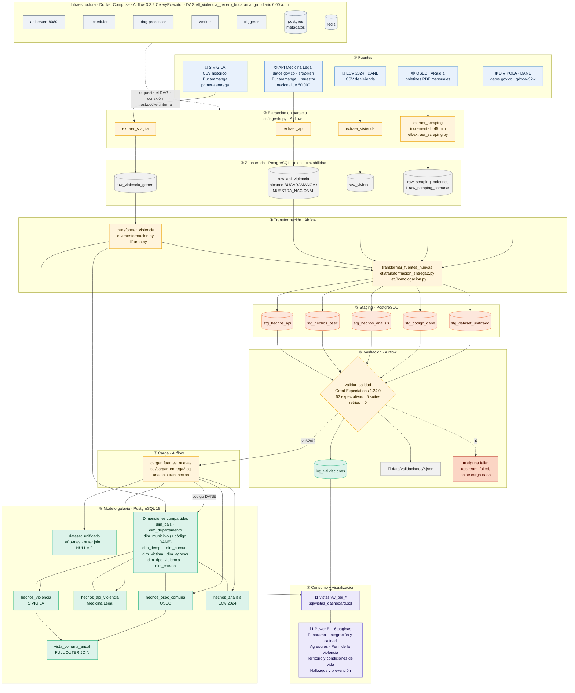
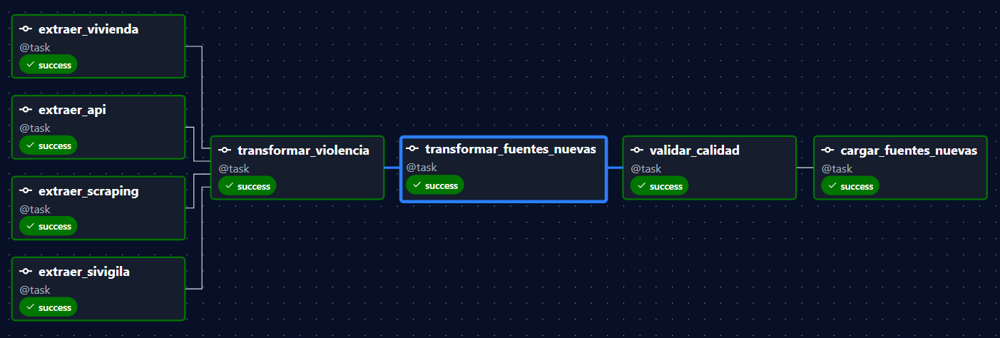

# Documento técnico · Segunda entrega

**Proyecto:** Análisis ETL de la violencia de género contra las mujeres en Bucaramanga (ODS 5)
**Curso:** ETL (G51) · Ingeniería de Datos e Inteligencia Artificial
**Repositorio:** ver `README.md` para la documentación completa, la instalación y la estructura del código

---

## Contenido

1. [Objetivos refinados](#1-objetivos-refinados)
2. [Resumen del EDA y de las visualizaciones producidas](#2-resumen-del-eda-y-de-las-visualizaciones-producidas)
3. [Detalles de la API y razones de su elección](#3-detalles-de-la-api-y-razones-de-su-elección)
4. [Diagrama de arquitectura actualizado](#4-diagrama-de-arquitectura-actualizado)
5. [Pasos del pipeline ETL](#5-pasos-del-pipeline-etl)
6. [Diseño del DAG de Airflow](#6-diseño-del-dag-de-airflow)
7. [Supuestos y decisiones de transformación](#7-supuestos-y-decisiones-de-transformación)
8. [Resumen de la suite de validación de Great Expectations](#8-resumen-de-la-suite-de-validación-de-great-expectations)
9. [Ejemplos de visualizaciones e insights](#9-ejemplos-de-visualizaciones-e-insights)

---

## 1. Objetivos refinados

**Pregunta global del proyecto**

> ¿Por qué ocurre la violencia de género contra las mujeres en Colombia, cómo se manifiesta según los factores sociodemográficos y familiares de víctimas y agresores, y qué estrategias de prevención pueden formularse a partir de un análisis de los datos?

En la primera entrega el análisis se apoyó en una sola fuente (SIVIGILA). En la segunda, el alcance se refina hacia **Bucaramanga** y hacia la **integración de fuentes**, con tres objetivos:

1. **Integrar fuentes heterogéneas en un Data Warehouse.** Consolidar SIVIGILA, la API de Medicina Legal, la Encuesta de Calidad de Vida 2024 (DANE) y los boletines del Observatorio de Seguridad y Convivencia (OSEC) en un modelo de constelación de hechos (esquema galaxia), mediante un pipeline orquestado con Apache Airflow que se ejecuta todos los días.
2. **Garantizar la calidad de los datos antes de la carga.** Convertir los hallazgos del EDA en 62 reglas de Great Expectations que se evalúan entre la transformación y la carga, de modo que el modelo final y el dashboard solo reciban datos validados.
3. **Caracterizar la violencia contra las mujeres en Bucaramanga y proponer estrategias de prevención.** Describir el fenómeno según el vínculo con el agresor, el ciclo de vida de la víctima, el tipo de violencia, el territorio (comuna) y el contexto socioeconómico, y presentar los resultados en un dashboard de Power BI.

---

## 2. Resumen del EDA y de las visualizaciones producidas

El EDA de la segunda entrega (`Docs/notebook/eda_perfilamiento.ipynb`) se hace **antes de transformar**: las cuatro fuentes se perfilan tal como llegan, con las mismas preguntas (tipos de datos, faltantes, duplicados, atípicos, variables clave y estadísticas básicas).

| Fuente | Registros perfilados | Uso |
|---|---|---|
| Scraping OSEC (16 boletines, may-2025 a ago-2026) | 1.344 filas por comuna | Denuncias de violencia intrafamiliar y delitos sexuales por comuna |
| API Medicina Legal – Bucaramanga | 3.386 casos (2015-2024) | Análisis principal de la API |
| API Medicina Legal – muestra nacional | 50.000 casos | Comparar Bucaramanga con Colombia |
| ECV 2024 – vivienda | 85.106 viviendas (archivo nacional) | Estrato, tipo de vivienda y zona |
| SIVIGILA (primera entrega) | 17.104 casos | Casos individuales con comuna, hora y agresor |

**Visualizaciones producidas en el EDA** (21 gráficas en `Docs/notebook/graficas_eda/`):

| Bloque | Gráficas |
|---|---|
| Comparación de fuentes | registros y columnas por fuente |
| OSEC | serie mensual, variación frente a la base, ranking de comunas, mapa de calor comuna-mes |
| API Medicina Legal | faltantes por columna, días de incapacidad, casos por año y sexo, tipo de violencia, ciclo vital, agresor, escenario, rango de hora, ciclo vital vs. agresor, Bucaramanga vs. Colombia |
| ECV 2024 | distribución por estrato; tipo de vivienda y zona por estrato |
| SIVIGILA | faltantes, edad del agresor, casos por año, casos por comuna |

**Hallazgos del EDA que guiaron la transformación**

| Hallazgo | Decisión |
|---|---|
| La falta de dato viene escrita de muchas formas ("Sin información", "No aplica", vacío) | Unificar en `NO REPORTADO` |
| La hora viene en formatos distintos (12 h en SIVIGILA, rangos de 3 h en la API) | Convertir a turno (mañana, tarde, noche, no reportado) con `etl/turno.py` |
| La comuna se escribe distinto en SIVIGILA y en el OSEC | Unir por número de comuna (1-17), no por nombre |
| La Policía corrige meses anteriores entre boletines | Usar la cifra del boletín más reciente |
| Estratos 0, 8 y 9 en la ECV | Cargar solo estratos 1 a 6 |
| Edad del agresor fuera de 10 a 99 años en SIVIGILA | Dejarla como desconocida sin borrar el caso |
| Categorías distintas entre SIVIGILA y la API | Tabla de homologación (`etl/homologacion.py`) |

---

## 3. Detalles de la API y razones de su elección

| Aspecto | Detalle |
|---|---|
| Conjunto | Violencia intrafamiliar · Instituto Nacional de Medicina Legal y Ciencias Forenses |
| Portal | Datos Abiertos Colombia (`datos.gov.co`), plataforma Socrata |
| Endpoint | `https://www.datos.gov.co/resource/ers2-kerr.json` (API SODA, formato JSON) |
| Autenticación | No requiere token |
| Columnas | 36 (edad, sexo, ciclo vital, municipio DANE, mes, rango de hora, zona, escenario, presunto agresor, días de incapacidad, entre otras) |
| Consulta 1 · Bucaramanga | `$where=codigo_dane_municipio='68001'`, `$limit=50000`, `$order=id` → **3.386 casos (2015-2024)** |
| Consulta 2 · Muestra nacional | `$limit=10000` con `$offset` de 0 a 40.000 (5 páginas), `$order=a_o_del_hecho DESC, id` → **50.000 casos** |
| Tolerancia a fallos | 3 intentos con espera de 5 s entre ellos; además, 2 reintentos de la tarea en Airflow |
| Destino | `raw_api_violencia`, con la columna `alcance` (BUCARAMANGA / MUESTRA_NACIONAL) y la llave `(id, alcance)` |

**¿Por qué esta API?**

- **Es una fuente oficial e independiente de SIVIGILA.** SIVIGILA registra la atención en salud; Medicina Legal registra la valoración forense. Tener las dos permite contrastar el fenómeno desde dos instituciones.
- **Trae el código DANE del municipio**, la misma llave que se usa en el modelo (`dim_municipio.codigo_dane`), lo que facilita la integración.
- **Permite filtrar desde la consulta (SoQL).** Pedir solo `68001` trae todos los casos de Bucaramanga, en lugar de una muestra nacional sesgada a 2015 (que es lo que devuelve la API sin filtros).
- **Se actualiza en el portal** y es pública y gratuita, lo que permite que el DAG la consulte todos los días.
- **Aporta variables que SIVIGILA no tiene**, como los días de incapacidad médico-legal (gravedad de la lesión) y el contexto del hecho.

**Limitación encontrada:** el conjunto publicado en la API **no incluye violencia de pareja** (solo violencia entre otros familiares, contra niños, niñas y adolescentes y contra personas mayores). Por eso la comparación con SIVIGILA se limita a los agresores familiares.

Además de esta API, el pipeline consulta el catálogo **DIVIPOLA** del DANE (`datos.gov.co/resource/gdxc-w37w.json`) para obtener el código DANE, la latitud y la longitud de los municipios.

---

## 4. Diagrama de arquitectura actualizado

El diagrama incluye Airflow (orquestación), la validación con Great Expectations y el bloqueo de la carga cuando una regla falla.




---

## 5. Pasos del pipeline ETL

| Paso | Qué ocurre | Código |
|---|---|---|
| **1. Extracción** | Las cuatro fuentes se cargan en paralelo a la zona cruda de PostgreSQL, tal como llegan (todo como texto) y con columnas de trazabilidad (`fuente`, `fecha_carga`). Las cargas son idempotentes: se reemplazan en una sola transacción. El scraping es incremental: solo descarga los boletines nuevos | `etl/ingesta.py`, `etl/extraer_scraping.py` |
| **2. Transformación de SIVIGILA** | Limpieza de textos, fechas, edades y booleanos; cálculo del turno; construcción del modelo estrella (`hechos_violencia` y sus dimensiones), ahora con `sexo_victima` e `id_comuna` | `etl/transformacion.py`, `etl/turno.py` |
| **3. Transformación de las fuentes nuevas** | API, OSEC y vivienda: filtro de Bucaramanga y de víctimas mujeres, homologación de categorías, serie mensual del OSEC, código DANE desde DIVIPOLA y construcción del `dataset_unificado`. Todo se escribe en **staging** (`stg_*`) | `etl/transformacion_entrega2.py`, `etl/homologacion.py` |
| **4. Validación** | Great Expectations evalúa 62 reglas sobre las 5 tablas de staging. Los resultados se guardan en `log_validaciones` y en un JSON. Si una regla falla, el pipeline se detiene | `etl/validacion.py` |
| **5. Carga** | Se resuelven los ids de las dimensiones y staging pasa al modelo final en **una sola transacción**. Un control final verifica que ninguna fila de staging quede sin cargar | `sql/cargar_entrega2.sql` |
| **6. Consumo** | 11 vistas `vw_pbi_*` preparan los datos para Power BI | `sql/vistas_dashboard.sql` |

---

## 6. Diseño del DAG de Airflow

El DAG `etl_violencia_genero_bucaramanga` (`dags/dag_violencia_genero.py`) corre en **Apache Airflow 3.3.2** sobre Docker (CeleryExecutor), con una imagen propia que agrega `pandas`, `beautifulsoup4`, `pdfplumber`, `python-dotenv` y `great_expectations==1.24.0`. Las tareas se definen con la API TaskFlow (`@task`).



```
extraer_sivigila ─┐
extraer_api ──────┤
extraer_vivienda ─┼─> transformar_violencia ─> transformar_fuentes_nuevas ─> validar_calidad ─> cargar_fuentes_nuevas
extraer_scraping ─┘
```

| # | Tarea | Lee | Escribe |
|---|---|---|---|
| 1 | `extraer_sivigila` | `data/bucaramanga_violencia.csv` | `raw_violencia_genero` |
| 2 | `extraer_api` | API Medicina Legal | `raw_api_violencia` |
| 3 | `extraer_vivienda` | `data/vivienda.CSV` | `raw_vivienda` |
| 4 | `extraer_scraping` | Boletines OSEC (PDF) | `raw_scraping_boletines`, `raw_scraping_comunas` |
| 5 | `transformar_violencia` | `raw_violencia_genero` | `hechos_violencia` + dimensiones |
| 6 | `transformar_fuentes_nuevas` | `raw_*`, modelo SIVIGILA, DIVIPOLA | `stg_*` |
| 7 | `validar_calidad` | `stg_*` | `log_validaciones`, JSON |
| 8 | `cargar_fuentes_nuevas` | `stg_*` | `hechos_api_violencia`, `hechos_osec_comuna`, `hechos_analisis`, `dataset_unificado` |

| Parámetro | Valor | Justificación |
|---|---|---|
| `schedule` | `0 6 * * *` | Ejecución diaria a las 6:00 a. m. (hora de Colombia): detecta a tiempo los boletines mensuales del OSEC y las actualizaciones de la API |
| `catchup` | `False` | No ejecuta los días pasados desde `start_date` |
| `max_active_runs` | `1` | Dos ejecuciones nunca escriben al mismo tiempo en las mismas tablas |
| `retries` / `retry_delay` | `2` / 5 min | Recupera fallas temporales de red (DNS, sitios lentos) |
| `retries` en `validar_calidad` | `0` | Un error de calidad no se corrige reintentando |
| `execution_timeout` en `extraer_scraping` | 45 min | La primera descarga de los PDF tarda ~11 minutos |

**Por qué este diseño:** las extracciones son independientes y corren en paralelo; la transformación espera a que terminen las cuatro; la validación se ubica **entre la transformación y la carga** para que un error de calidad deje la carga en estado *upstream_failed* y el modelo final conserve los datos validados de la ejecución anterior. El Data Warehouse es el PostgreSQL 18 local, al que los contenedores se conectan por `host.docker.internal`; Airflow guarda su propio historial en un PostgreSQL interno separado.

---

## 7. Supuestos y decisiones de transformación

| Decisión | Motivo |
|---|---|
| Separar la zona cruda (una tabla por fuente) de la transformación | Siempre se puede volver al dato original para auditar; la capa cruda no filtra |
| Escribir primero en staging (`stg_*`) y cargar después | Permite validar con Great Expectations antes de tocar el modelo final |
| Solo víctimas mujeres en las tablas de hechos nuevas y en el dashboard | Enfoque ODS 5; la capa cruda conserva todos los casos |
| La comuna se une por **número**, no por nombre | Los nombres cambian entre fuentes ("LA CIUDADELA" = "CIUDADELA REAL DE MINAS"; "LAGOS DEL CACIQUE" = "TEJAR") |
| Comunas 21 a 30, "GIRÓN", "FLORIDABLANCA" → SIN COMUNA | Corresponden a otros municipios del área metropolitana |
| La hora se convierte en turno | Las fuentes usan formatos distintos; el turno es comparable entre ellas |
| Categorías homologadas (agresor, ciclo de vida, área, mes, días de incapacidad) | Vocabulario común entre SIVIGILA y la API, verificado con una autoprueba de 58 casos |
| OSEC: cifra del boletín más reciente y solo el bloque mensual | La Policía corrige meses anteriores; el acumulado duplicaría casos |
| Vivienda: solo Bucaramanga (68 / 001) y estratos 1 a 6 | Los códigos 0, 8 y 9 no son estratos |
| El estrato se presenta como "nivel socioeconómico" | Es una aproximación; no es una medida de pobreza |
| Código DANE desde DIVIPOLA, con respaldo 68001 | Es la llave oficial para unir fuentes; si el servicio no responde, Bucaramanga sigue identificada |
| `dataset_unificado` empieza en 2015 | Los hechos antiguos notificados tarde dejarían meses casi vacíos y una falsa tendencia |
| En `dataset_unificado`, NULL ≠ 0 | NULL = la fuente no cubre ese mes; 0 = la cubre y no hubo casos |
| Las fuentes se comparan, no se suman | SIVIGILA y Medicina Legal cuentan casos atendidos; el OSEC cuenta denuncias |

**Integración (merge) en tres niveles:** (1) las cuatro tablas de hechos comparten `dim_municipio`, `dim_tiempo` y `dim_comuna`; (2) `dataset_unificado` une las fuentes por `(año, mes)` con un merge externo sobre un calendario continuo de 140 meses (enero de 2015 a agosto de 2026); (3) `vista_comuna_anual` une SIVIGILA y OSEC por `(comuna, año)` con un `FULL OUTER JOIN`.

```mermaid
erDiagram
    %% ===== Jerarquía geográfica =====
    dim_pais ||--o{ dim_departamento : "contiene"
    dim_departamento ||--o{ dim_municipio : "contiene"

    %% ===== Estrella 1: SIVIGILA =====
    dim_municipio ||--o{ hechos_violencia : "lugar"
    dim_tiempo ||--o{ hechos_violencia : "año-mes-semana"
    dim_victima ||--o{ hechos_violencia : "víctima"
    dim_agresor ||--o{ hechos_violencia : "agresor"
    dim_tipo_violencia ||--o{ hechos_violencia : "naturaleza"
    dim_comuna |o--o{ hechos_violencia : "comuna"

    %% ===== Estrella 2: Medicina Legal (API) =====
    dim_municipio ||--o{ hechos_api_violencia : "lugar"
    dim_tiempo ||--o{ hechos_api_violencia : "año-mes"

    %% ===== Estrella 3: OSEC (scraping) =====
    dim_comuna ||--o{ hechos_osec_comuna : "comuna"
    dim_tiempo ||--o{ hechos_osec_comuna : "año-mes"

    %% ===== Estrella 4: ECV 2024 (vivienda) =====
    dim_departamento ||--o{ hechos_analisis : "departamento"
    dim_municipio ||--o{ hechos_analisis : "lugar"
    dim_estrato ||--o{ hechos_analisis : "estrato"

    %% ===== Conjuntos derivados (merge) =====
    dim_tiempo ||..o| dataset_unificado : "anio + mes (lógica)"
    dim_comuna ||..o{ vista_comuna_anual : "id_comuna (lógica)"

    dim_pais {
        SERIAL id_pais PK
        VARCHAR nombre_pais UK "Colombia"
    }
    dim_departamento {
        SERIAL id_departamento PK
        INT id_pais FK
        VARCHAR nombre_departamento
    }
    dim_municipio {
        SERIAL id_municipio PK
        INT id_departamento FK
        VARCHAR nombre_municipio
        VARCHAR area "cabecera / centro poblado / rural"
        VARCHAR codigo_dane "DIVIPOLA, ej. 68001"
        NUMERIC latitud
        NUMERIC longitud
    }
    dim_tiempo {
        SERIAL id_tiempo PK
        INT year
        INT mes
        INT semana "0 = la fuente no trae semana"
    }
    dim_comuna {
        SMALLINT id_comuna PK "1-17, 101-103, 0"
        SMALLINT numero_comuna "1 a 17"
        VARCHAR nombre_comuna UK
        VARCHAR nombre_alterno
        VARCHAR tipo "COMUNA / CORREGIMIENTO / SIN UBICACION"
    }
    dim_victima {
        SERIAL id_victima PK
        VARCHAR grupo_edad
        VARCHAR ciclo_vida
        VARCHAR tipo_seguridad_social
        VARCHAR actividad
    }
    dim_agresor {
        SERIAL id_agresor PK
        INT edad_agre "10 a 99"
        VARCHAR sexo_agre
        VARCHAR parentezco_vict
    }
    dim_tipo_violencia {
        SERIAL id_tipo_violencia PK
        INT naturaleza UK
        VARCHAR def_naturaleza
    }
    dim_estrato {
        SMALLINT id_estrato PK "1 a 6"
        VARCHAR nombre_estrato UK
        VARCHAR nivel_estrato
    }
    hechos_violencia {
        SERIAL id_hecho PK
        INT id_municipio FK
        INT id_tiempo FK
        INT id_victima FK
        INT id_agresor FK
        INT id_tipo_violencia FK
        SMALLINT id_comuna FK
        VARCHAR sexo_victima
        VARCHAR escenario
        VARCHAR zona_conf
        VARCHAR con_fin
        BOOLEAN pac_hos
        BOOLEAN sust_vict
        DATE fecha_hecho
        VARCHAR turno "MAÑANA / TARDE / NOCHE / NO REPORTADO"
        VARCHAR fuente
    }
    hechos_api_violencia {
        SERIAL id_hecho_api PK
        TEXT id_caso_api UK
        INT id_municipio FK
        INT id_tiempo FK
        VARCHAR ciclo_vida "homologado"
        VARCHAR grupo_agresor "homologado"
        VARCHAR presunto_agresor
        VARCHAR sexo_agresor
        VARCHAR tipo_violencia
        VARCHAR contexto
        VARCHAR escenario
        VARCHAR turno
        VARCHAR dias_incapacidad "rangos"
        VARCHAR fuente
    }
    hechos_osec_comuna {
        SERIAL id_hecho_osec PK
        SMALLINT id_comuna FK
        INT id_tiempo FK
        VARCHAR delito "VIF / DELITOS SEXUALES"
        INT casos ">= 0"
        VARCHAR publicado_en "boletín AAAAMM"
        VARCHAR fuente
    }
    hechos_analisis {
        SERIAL id_hecho_analisis PK
        INT id_departamento FK
        INT id_municipio FK
        SMALLINT id_estrato FK
        SMALLINT zona_vivienda
        SMALLINT tipo_vivienda
        SMALLINT tiene_energia_electrica
    }
    dataset_unificado {
        SMALLINT anio PK
        SMALLINT mes PK
        DATE fecha_mes
        INT siv_casos_total
        INT siv_casos_mujeres
        INT siv_mujeres_agresor_pareja
        INT siv_mujeres_agresor_familiar
        INT siv_mujeres_turno_noche
        INT siv_mujeres_fallecidas
        INT api_casos_mujeres
        INT api_mujeres_incapacidad_grave
        INT osec_denuncias_vif
        INT osec_denuncias_sexuales
        INT ecv_viviendas_bucaramanga
        NUMERIC ecv_pct_estrato_1_2
        NUMERIC ecv_pct_estrato_5_6
        SMALLINT fuentes_con_dato "1 a 3"
    }
    vista_comuna_anual {
        SMALLINT id_comuna
        SMALLINT numero_comuna
        VARCHAR nombre_comuna
        VARCHAR tipo
        INT anio
        BIGINT siv_casos_mujeres
        BIGINT siv_casos_total
        BIGINT osec_denuncias_vif
        BIGINT osec_denuncias_sexuales
        BIGINT osec_meses_con_dato
    }
    log_validaciones {
        SERIAL id_log PK
        TIMESTAMP fecha_ejecucion
        VARCHAR suite
        VARCHAR tabla
        VARCHAR expectativa
        VARCHAR columna
        BOOLEAN exito
        TEXT valor_observado
        INT filas_inesperadas
        NUMERIC porcentaje_inesperado
        TEXT ejemplos_inesperados
        TEXT descripcion
    }
```



---

## 8. Resumen de la suite de validación de Great Expectations

Se usa **Great Expectations 1.24.0** (GX Core) con un contexto efímero y la API de pandas. Hay una suite por tabla de staging, y cada regla incluye en el código la razón que la originó en el EDA.

| Suite | Tabla | Reglas | Qué garantiza |
|---|---|---|---|
| `suite_hechos_api` | `stg_hechos_api` | 18 | Casos únicos; años entre 2015 y el actual; mes 1-12; categorías homologadas; turno válido; al menos el 90 % con agresor clasificado (`mostly=0.9`) |
| `suite_hechos_osec` | `stg_hechos_osec` | 14 | Un valor por comuna, mes y delito; comunas existentes en `dim_comuna`; solo los dos delitos extraídos; casos ≥ 0; periodo AAAAMM |
| `suite_hechos_analisis` | `stg_hechos_analisis` | 11 | Estratos 1 a 6; zona y tipo de vivienda válidos; toda vivienda con estrato tiene energía eléctrica |
| `suite_codigo_dane` | `stg_codigo_dane` | 3 | Códigos de 5 dígitos; Bucaramanga (68001) siempre presente |
| `suite_dataset_unificado` | `stg_dataset_unificado` | 16 | Una fila por mes; `fuentes_con_dato` entre 1 y 3; conteos ≥ 0; casos de mujeres ≤ total; porcentajes entre 0 y 100 |
| **Total** | | **62** | |

**Integración con el DAG.** La tarea `validar_calidad` lee las tablas `stg_*`, evalúa las suites y registra cada regla en la tabla `log_validaciones` (fecha, suite, columna, resultado, filas inesperadas, ejemplos y descripción) y en `data/validaciones/validacion_AAAAMMDD_HHMMSS.json`. Si una regla falla, la tarea termina en error y `cargar_fuentes_nuevas` no se ejecuta.

**Prueba de bloqueo.** Se alteraron datos de staging a propósito (estratos con valor 9). `suite_hechos_analisis` detectó las filas inválidas y la ejecución se detuvo con el mensaje *"Validación de calidad FALLIDA … No se cargará el modelo final"*. Al regenerar staging, la validación volvió a pasar.

**Resultado de la última ejecución: 62 de 62 reglas cumplidas.**

| Suite | Filas validadas | Cumplidas |
|---|---|---|
| `suite_hechos_api` | 1.936 | 18 / 18 |
| `suite_hechos_osec` | 1.176 | 14 / 14 |
| `suite_hechos_analisis` | 427 | 11 / 11 |
| `suite_codigo_dane` | 33 | 3 / 3 |
| `suite_dataset_unificado` | 140 | 16 / 16 |

Las 4 filas de Medicina Legal sin agresor reportado están dentro del umbral del 90 % y se muestran en el dashboard como "filas toleradas por umbral".

---

## 9. Ejemplos de visualizaciones e insights

El dashboard de Power BI (`Docs/dashboard/dashboard_violencia_genero.pbix`) lee solo las vistas `vw_pbi_*`, alimentadas por el modelo final validado. Tiene seis páginas:

| Página | Pregunta | Visualizaciones |
|---|---|---|
| 1. Panorama | ¿Cuánta violencia hay y cómo ha cambiado? | Tarjetas por fuente, tendencia anual SIVIGILA vs. Medicina Legal, denuncias mensuales del OSEC |
| 2. Integración y calidad | ¿Se puede confiar en los datos? | Resultado de Great Expectations, embudo de integración por fuente, composición del dataset unificado, tabla de las 62 reglas |
| 3. Agresores | ¿Quién ejerce la violencia? | Víctimas según vínculo con el agresor; agresores familiares SIVIGILA vs. Medicina Legal |
| 4. Perfil de la violencia | ¿A quién afecta y cómo? | Ciclo de vida, tipo de violencia, momento del día, consumo de sustancias |
| 5. Territorio y condiciones de vida | ¿Dónde ocurre y en qué contexto? | Comunas con más casos, indicadores de vivienda, nivel socioeconómico |
| 6. Hallazgos y prevención | ¿Qué hacer? | Hallazgos y estrategias basadas en los datos |

<!-- Reemplazar por las capturas reales del dashboard -->


**Insights principales** (11.763 casos de violencia contra mujeres registrados por SIVIGILA en Bucaramanga):

1. **La violencia viene del entorno cercano.** El 62,4 % de las agresiones proviene de la pareja o expareja (33,2 %, 3.905 casos) o del padre, la madre o los padrastros (29,2 %, 3.434 casos).
2. **Las niñas también son víctimas dentro del hogar.** La negligencia y el abandono son el segundo tipo de violencia (26,2 %), asociado al peso de padres y padrastros como agresores.
3. **La juventud y la adultez concentran los casos:** 23,0 % y 22,6 % de las víctimas, etapas en las que predomina la violencia de pareja.
4. **La violencia física es la más registrada** (39,3 %, 4.624 casos).
5. **Tres comunas concentran el 40,3 % de los casos con comuna identificada:** San Francisco (1.917 casos, 18,5 %), Norte (1.316) y Occidental (941).
6. **Contexto socioeconómico:** el 45,7 % de las viviendas encuestadas en Bucaramanga está en estratos 1 y 2.
7. **Vacíos de información:** el 73,8 % de los casos no registra el momento del día, y la API de Medicina Legal no incluye violencia de pareja; ninguna fuente por sí sola muestra el problema completo.

**Estrategias de prevención derivadas:** prevención de la violencia de pareja en población joven y adulta; crianza sin violencia y seguimiento a la negligencia; focalización de comisarías de familia y atención psicosocial en San Francisco, Norte y Occidental; articulación con programas sociales en estratos 1 y 2; detección temprana en salud y educación; mejora del registro del horario del hecho en SIVIGILA, y monitoreo continuo con el pipeline ETL.