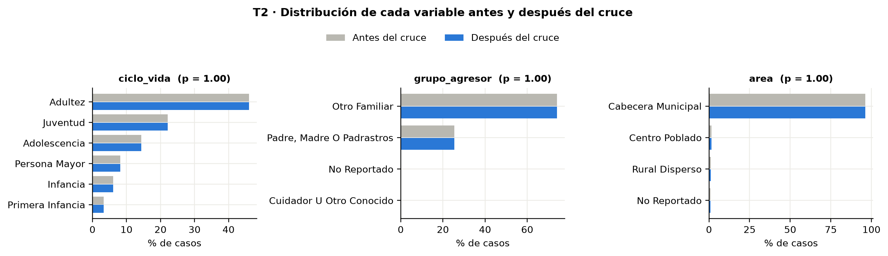
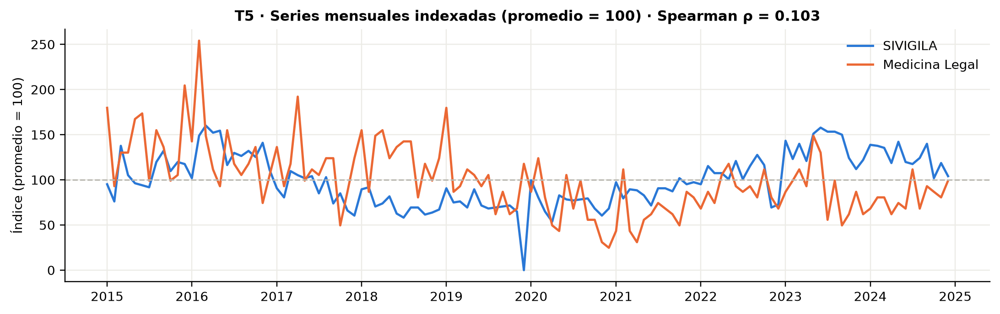
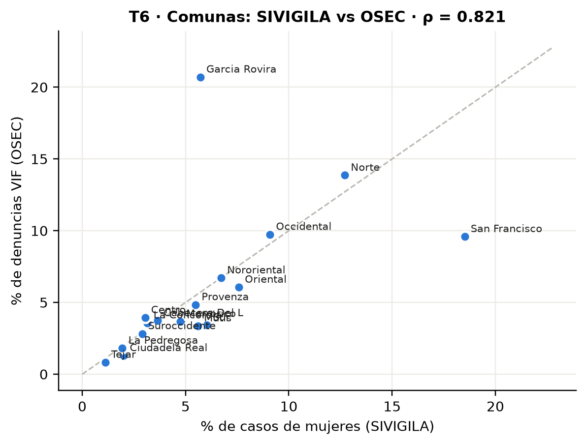

# Evaluación estadística del merge

Generado: 2026-11-23 01:57 · Nivel de significancia α = 0.05

**Pregunta:** ¿unir las fuentes de serie de tiempo (SIVIGILA, Medicina Legal, OSEC) con la fuente estacionaria
(ECV 2024) es estadísticamente válido y no sesga los datos?

| Prueba | Resultado | Conclusión |
|---|---|---|
| T1 Conservación de registros | 1,936 casos antes (stg_hechos_api (staging)) → 1,936 después; 0 duplicados; 0 faltantes | ✅ El cruce no pierde ni duplica casos |
| T2 Distribuciones antes vs después (χ²) | Menor p-valor: ciclo_vida p = 1.0; distancia de variación máxima = 0.0000 | ✅ Ninguna distribución cambia (p ≥ 0.05): el cruce no sesga los casos |
| T3 Series del dataset unificado | siv_casos_mujeres: 129 meses, diferencia máx. 0; api_casos_mujeres: 120 meses, diferencia máx. 0 | ✅ Las series son idénticas a las de cada fuente |
| T4 Fuente estacionaria (ECV) en el tiempo | ecv_viviendas_bucaramanga: 1 valor(es) distinto(s); ecv_pct_estrato_1_2: 1 valor(es) distinto(s); ecv_pct_estrato_5_6: 1 valor(es) distinto(s) | ✅ Es constante: no crea tendencia ni estacionalidad falsa |
| T5 Concordancia temporal (Spearman) | Mensual SIVIGILA vs Medicina Legal: ρ = 0.103 (p = 0.263, n = 120); anual: ρ = 0.091 (p = 0.803, n = 10); SIVIGILA vs OSEC: ρ = 0.235 (p = 0.349, n = 18) | Correlación nula y no significativa: las dos series NO se mueven juntas en el tiempo. Miden procesos distintos (atención en salud vs. valoración forense), por eso se ponen lado a lado y nunca se suman |
| T6 Concordancia territorial (Spearman, comunas) | ρ = 0.821 (p < 0.001, n = 17); mismo periodo del OSEC: ρ = 0.765 (p < 0.001, n = 17) | Correlación muy fuerte: las comunas con más casos tienden a tener más denuncias |
| T7 Sesgo por cobertura del OSEC (χ²) | 110 casos con OSEC vs 1,826 sin OSEC; p = 0.330; V de Cramér = 0.042 | ✅ Diferencia despreciable (V < 0.1) |
| T8 Aporte al objetivo del modelo (V de Cramér) | ciclo_vida = 0.69; nivel_estrato = 0.035; zona_vivienda = 0.035; osec_disponible = 0.015; area = 0.055 | Las variables cruzadas (estrato, zona, OSEC) aportan mucho menos que la edad: se usan en el análisis, no en el modelo |

## Interpretación

1. **El cruce es neutro sobre los casos.** No cambia el número de casos (T1), ni su distribución (T2), ni las series
   mensuales de cada fuente (T3). Unir no inventa ni borra información.
2. **La ECV es estacionaria y así se trata.** Es una foto de 2024 y en el dataset unificado tiene un solo valor
   (T4). Por eso no puede crear tendencias falsas, pero tampoco puede explicar cambios mes a mes: se usa como
   **contexto socioeconómico**, no como variable temporal.
3. **En el tiempo, las fuentes NO se mueven juntas (T5), y eso valida el diseño del merge.** Cada fuente refleja un proceso institucional distinto (atención en salud, valoración forense, denuncia), con sus propios cambios de cobertura y registro. Sumarlas mezclaría procesos distintos; por eso el dataset unificado las pone lado a lado, una columna por fuente. **En el territorio sí concuerdan (T6):** las comunas con más casos atendidos son también las de más denuncias, así que la comparación por comuna es válida para priorizar territorios.
4. **Decisión para el modelo de ML.** El OSEC solo cubre una parte de los casos (T7) y las variables cruzadas aportan
   poco al objetivo (T8). Por eso el modelo usa las variables propias del caso y los datos cruzados se reservan para el
   reporte analítico. No se imputan valores: el vacío significa "sin dato".

