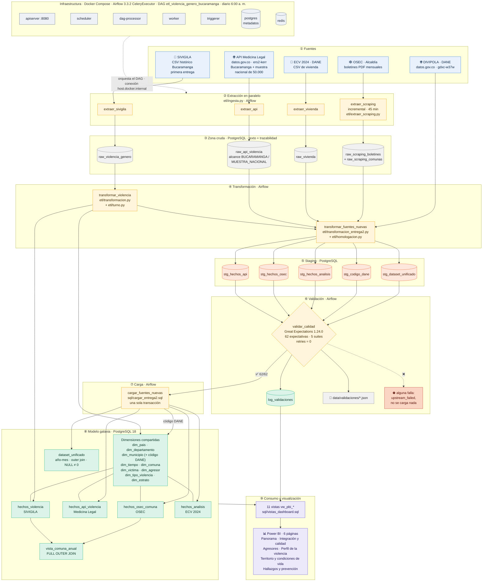
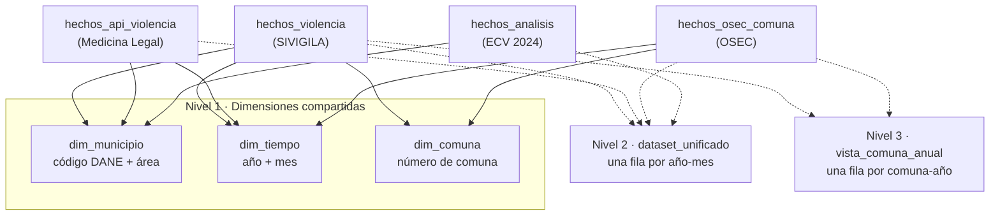
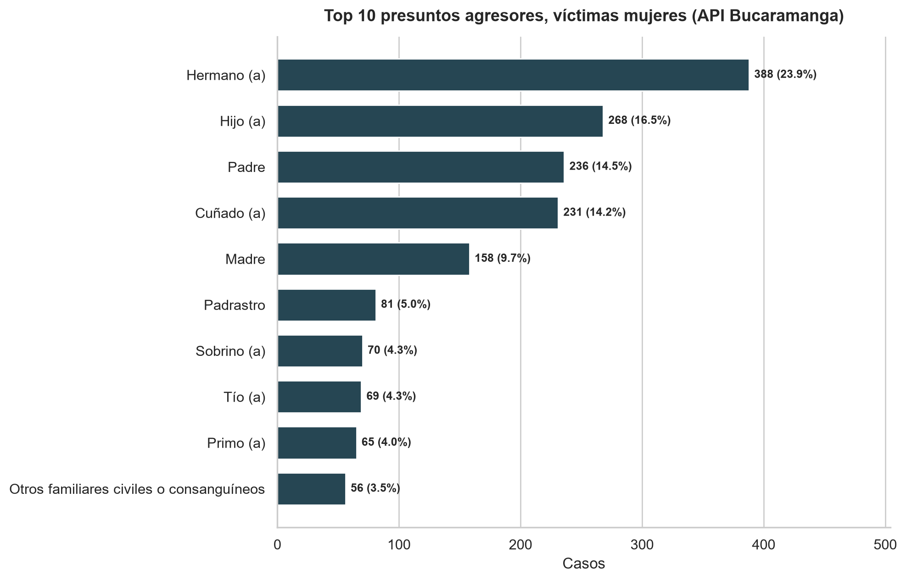
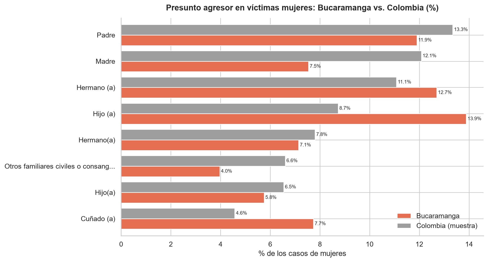
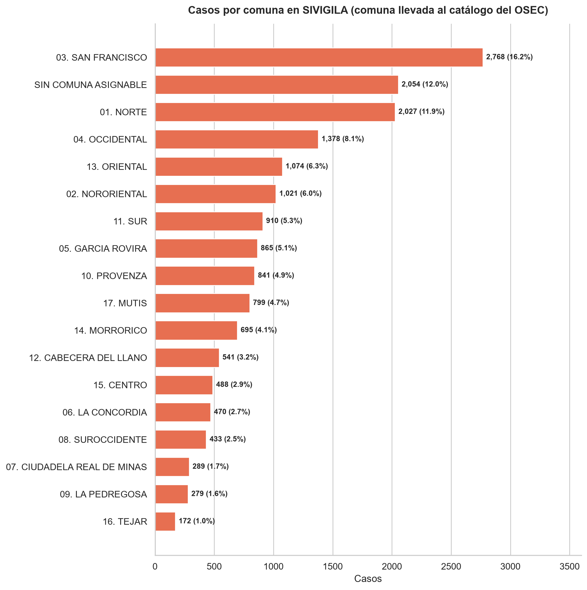
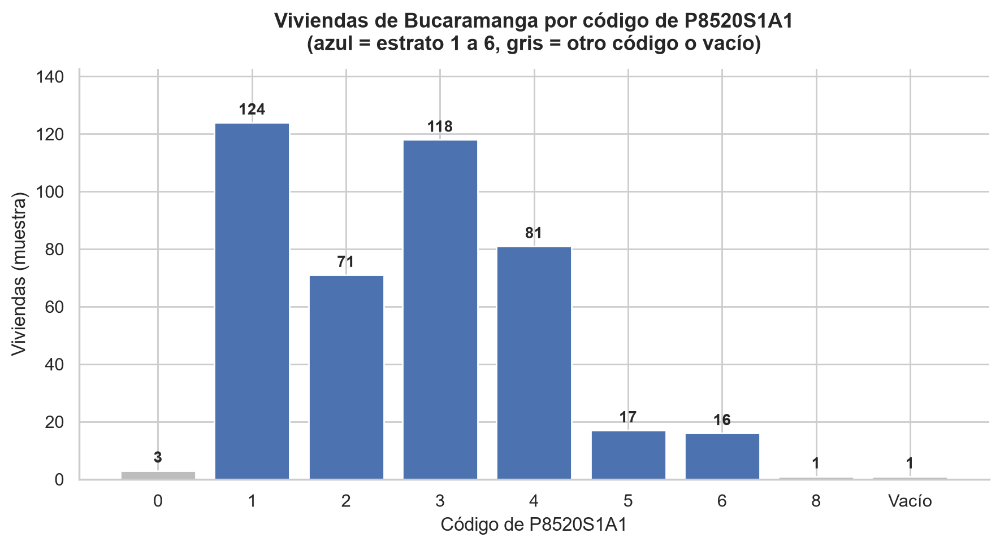

<div align="center">

# 🛡️ Análisis ETL de la Violencia de Género en Colombia
### Un enfoque de datos para el ODS 5 — Igualdad de Género · Caso Bucaramanga


*Ingeniería de Datos e Inteligencia Artificial · Curso ETL (G51) · Proyecto — Segunda Entrega*

</div>

---

## 📑 Tabla de contenido

1. [Objetivo del proyecto](#-objetivo-del-proyecto)
2. [Alineación con los ODS](#-alineación-con-los-ods)
3. [Pregunta problema](#-pregunta-problema)
4. [Novedades de la segunda entrega](#-novedades-de-la-segunda-entrega)
5. [Fuentes de datos y justificación](#-fuentes-de-datos-y-justificación)
6. [Arquitectura del proyecto](#-arquitectura-del-proyecto)
7. [Pasos del pipeline ETL](#-pasos-del-pipeline-etl)
8. [Diseño del DAG de Airflow](#-diseño-del-dag-de-airflow)
9. [Supuestos y decisiones de transformación](#-supuestos-y-decisiones-de-transformación)
10. [Integración de las fuentes (merge)](#-integración-de-las-fuentes-merge)
11. [Validación de calidad con Great Expectations](#-validación-de-calidad-con-great-expectations)
12. [Modelo de datos (constelación de hechos)](#-modelo-de-datos-constelación-de-hechos)
13. [Proceso de EDA](#-proceso-de-eda)
14. [Visualizaciones e insights](#-visualizaciones-e-insights)
15. [Decisiones clave](#-decisiones-clave)
16. [Stack tecnológico](#️-stack-tecnológico)
17. [Estructura del repositorio](#-estructura-del-repositorio)
18. [Instalación y ejecución](#-instalación-y-ejecución)
19. [Seguimiento del proyecto y control de versiones](#️-seguimiento-del-proyecto-y-control-de-versiones)
20. [Diccionario de datos](#-diccionario-de-datos)
21. [Equipo de trabajo](#-equipo-de-trabajo)
22. [Licencia](#-licencia)

> 📄 El **documento técnico** de la segunda entrega está en [`Docs/documento_tecnico.md`](Docs/documento_tecnico.md).

---

## 🎯 Objetivo del proyecto

Diseñar y construir un **pipeline ETL completo, orquestado y validado** que consolide fuentes oficiales sobre violencia de género en un **Data Warehouse relacional**, con el fin de entender **por qué ocurre**, **cómo se manifiesta** y **qué estrategias de prevención** pueden formularse a partir de la evidencia.

**Objetivos refinados para la segunda entrega**

1. **Integrar fuentes heterogéneas** (SIVIGILA, API de Medicina Legal, ECV 2024 del DANE y boletines del OSEC) en un modelo de constelación de hechos, mediante un pipeline orquestado con Apache Airflow que se ejecuta todos los días.
2. **Garantizar la calidad de los datos antes de la carga**, con 62 reglas de Great Expectations derivadas del EDA que bloquean la carga si alguna falla.
3. **Caracterizar la violencia contra las mujeres en Bucaramanga** según el vínculo con el agresor, el ciclo de vida de la víctima, el tipo de violencia, el territorio y el contexto socioeconómico, y presentar los resultados y las estrategias de prevención en un dashboard de Power BI.

## 🌍 Alineación con los ODS

| ODS | Nombre | Vínculo con el proyecto |
|---|---|---|
|  | **Igualdad de Género** | Meta 5.2: eliminar todas las formas de violencia contra las mujeres y las niñas. El proyecto documenta casos de violencia física, sexual, psicológica y por negligencia contra mujeres, e identifica patrones sociodemográficos, familiares y territoriales que sustenten políticas públicas de prevención. |

## ❓ Pregunta problema

> **Pregunta global:** ¿Por qué ocurre la violencia de género contra las mujeres en Colombia, cómo se manifiesta según los factores sociodemográficos y familiares de víctimas y agresores, y qué estrategias de prevención pueden formularse a partir de un análisis de los datos?

> **Pregunta de esta entrega:** ¿Cómo se manifiesta la violencia contra las mujeres en Bucaramanga según el vínculo con el agresor, el ciclo de vida de la víctima, el tipo de violencia, la comuna y el contexto socioeconómico, y qué aportan las fuentes complementarias (Medicina Legal, OSEC y ECV 2024) a esa caracterización?

La lógica de trabajo sigue el esquema **Por qué → Cómo → Qué**: *por qué* ocurre (factores de riesgo y contexto), *cómo* se manifiesta (tipo de violencia, relación agresor–víctima, territorio) y *qué* estrategias de prevención pueden formularse con respaldo en los datos.

## 🆕 Novedades de la segunda entrega

| Primera entrega | Segunda entrega |
|---|---|
| Una fuente (CSV de SIVIGILA) | Cuatro fuentes: CSV, **API**, CSV adicional y **web scraping** |
| Scripts ejecutados a mano | Pipeline orquestado con **Apache Airflow** (8 tareas, ejecución diaria) |
| Esquema estrella | **Constelación de hechos** (4 tablas de hechos con dimensiones compartidas) |
| Sin validación automática | **Great Expectations** (62 reglas) integrado al DAG, con bloqueo de la carga |
| Gráficas en el notebook | **Dashboard en Power BI** (6 páginas) alimentado solo con datos validados |
| Hora exacta del hecho | Hora clasificada en **turno** (mañana, tarde, noche, no reportado) |
| Comuna descartada por ruido | Comuna **homologada por número** para unir SIVIGILA y OSEC |

## 📂 Fuentes de datos y justificación

| # | Fuente | Tipo | Qué aporta | Periodo |
|---|---|---|---|---|
| 1 | SIVIGILA · Histórico de violencia de Bucaramanga (primera entrega) | CSV | Casos individuales atendidos en salud, con comuna, barrio, hora y agresor | Histórico |
| 2 | Medicina Legal · `datos.gov.co` (`ers2-kerr`) | **API** | 3.386 casos de violencia intrafamiliar en Bucaramanga + muestra nacional de 50.000 | 2015-2024 |
| 3 | ECV 2024 · DANE (`vivienda.CSV`) | CSV adicional | Estrato, tipo de vivienda y zona de las viviendas de Bucaramanga | 2024 |
| 4 | Observatorio OSEC · Alcaldía de Bucaramanga | **Web scraping** | Denuncias de violencia intrafamiliar y delitos sexuales por comuna | 2024-2026 |
| 5 | DIVIPOLA · DANE (`gdxc-w37w`) | API (catálogo) | Código DANE, latitud y longitud de los municipios | Vigente |

**¿Por qué la API de Medicina Legal?** Es una fuente oficial e independiente de SIVIGILA (valoración forense frente a atención en salud), trae el código DANE del municipio, permite filtrar Bucaramanga desde la consulta (SoQL) y aporta variables que SIVIGILA no tiene, como los días de incapacidad médico-legal. Los detalles de la consulta están en el [documento técnico](Docs/documento_tecnico.md#3-detalles-de-la-api-y-razones-de-su-elección).

**¿Por qué el OSEC?** Es una fuente local, actualizada cada mes y desagregada por comuna, que permite analizar el territorio dentro de la ciudad.

> ⚠️ Las fuentes **se comparan, no se suman**: SIVIGILA y Medicina Legal cuentan casos atendidos, mientras que el OSEC cuenta denuncias ante la Policía. Una misma agresión puede aparecer en varias fuentes.

## 🏗️ Arquitectura del proyecto

El flujo va de las fuentes a la visualización en nueve etapas. **Airflow** ejecuta las tareas en orden, **PostgreSQL** guarda cada capa (cruda, staging y modelo final) y **Great Expectations** decide si los datos pasan al modelo final.



## 🔄 Pasos del pipeline ETL

| Paso | Qué ocurre | Código |
|---|---|---|
| **1. Extracción** | Las cuatro fuentes se cargan **en paralelo** a la zona cruda, tal como llegan (todo como texto) y con `fuente` y `fecha_carga`. Las cargas son idempotentes (reemplazo en una sola transacción) y el scraping es incremental | `etl/ingesta.py`, `etl/extraer_scraping.py` |
| **2. Transformación de SIVIGILA** | Limpieza de textos, fechas, edades y booleanos; cálculo del turno; modelo estrella con `sexo_victima` e `id_comuna` | `etl/transformacion.py`, `etl/turno.py` |
| **3. Transformación de las fuentes nuevas** | Filtro de Bucaramanga y de víctimas mujeres, homologación, serie mensual del OSEC, código DANE desde DIVIPOLA y `dataset_unificado`. Todo se escribe en **staging** (`stg_*`) | `etl/transformacion_entrega2.py`, `etl/homologacion.py` |
| **4. Validación** | 62 reglas de Great Expectations sobre 5 tablas de staging; resultados en `log_validaciones` y en JSON. Si una falla, el pipeline se detiene | `etl/validacion.py` |
| **5. Carga** | Staging pasa al modelo final en **una sola transacción**, con un control que impide perder filas | `sql/cargar_entrega2.sql` |
| **6. Consumo** | 11 vistas `vw_pbi_*` alimentan el dashboard de Power BI | `sql/vistas_dashboard.sql` |

**Zona cruda y resultado de la primera ingesta (13-oct-2026)**

| Fuente | Tabla cruda | Estrategia de carga | Filas |
|---|---|---|---|
| CSV SIVIGILA | `raw_violencia_genero` | Reemplazo completo de la fuente `Historico_Bucaramanga` | 17.104 |
| API Medicina Legal | `raw_api_violencia` | Reemplazo por `alcance`: `BUCARAMANGA` y `MUESTRA_NACIONAL` (5 páginas de 10.000) | 3.386 + 50.000 |
| CSV vivienda ECV 2024 | `raw_vivienda` | Reemplazo completo (archivo nacional) | 85.106 |
| Scraping OSEC | `raw_scraping_boletines`, `raw_scraping_comunas` | **Incremental**: solo boletines nuevos | 16 / 1.344 |

El scraping procesó **16 boletines** (mayo 2025 – agosto 2026), todos con estado `OK`: 16 boletines × 2 delitos × 2 bloques (acumulado y mes) × 21 filas (17 comunas + 3 corregimientos + "No disponible") = 1.344 filas. La primera carga tardó ~11 minutos porque cada PDF tiene más de 60 páginas; en las ejecuciones diarias solo se descarga el boletín nuevo.

## 🌀 Diseño del DAG de Airflow

El DAG `etl_violencia_genero_bucaramanga` (`dags/dag_violencia_genero.py`) corre en **Apache Airflow 3.3.2** sobre Docker (CeleryExecutor), con una imagen propia (`Dockerfile` + `requirements-airflow.txt`).

<div align="center">


</div>

| # | Tarea | Qué hace | Lee | Escribe |
|---|---|---|---|---|
| 1 | `extraer_sivigila` | Carga el CSV de la primera entrega | `data/bucaramanga_violencia.csv` | `raw_violencia_genero` |
| 2 | `extraer_api` | Consulta la API de Medicina Legal | datos.gov.co | `raw_api_violencia` |
| 3 | `extraer_vivienda` | Carga el CSV de la ECV 2024 | `data/vivienda.CSV` | `raw_vivienda` |
| 4 | `extraer_scraping` | Descarga solo los boletines nuevos del OSEC | bucaramanga.gov.co | `raw_scraping_*` |
| 5 | `transformar_violencia` | Modelo estrella de SIVIGILA, con sexo y comuna | `raw_violencia_genero` | `hechos_violencia` + dimensiones |
| 6 | `transformar_fuentes_nuevas` | Limpieza, homologación y conjunto unificado | `raw_*` + modelo SIVIGILA + DIVIPOLA | `stg_*` |
| 7 | `validar_calidad` | 62 expectativas de Great Expectations | `stg_*` | `log_validaciones`, JSON |
| 8 | `cargar_fuentes_nuevas` | Pasa staging al modelo final en una transacción | `stg_*` | `hechos_api_violencia`, `hechos_osec_comuna`, `hechos_analisis`, `dataset_unificado` |

**Dependencias:** las tareas 1 a 4 corren **en paralelo**; la 5 espera a las cuatro; las tareas 6, 7 y 8 van **en secuencia**. Si `validar_calidad` falla, `cargar_fuentes_nuevas` queda en *upstream_failed* y el modelo conserva los datos validados de la ejecución anterior.

| Parámetro | Valor | Por qué |
|---|---|---|
| `schedule` | `0 6 * * *` | Ejecución diaria a las 6:00 a. m. (hora de Colombia) |
| `catchup` | `False` | No ejecuta los días pasados desde `start_date` |
| `max_active_runs` | `1` | Dos ejecuciones nunca escriben al mismo tiempo en las mismas tablas |
| `retries` / `retry_delay` | `2` / 5 min | Reintenta ante fallas temporales de red |
| `retries` en `validar_calidad` | `0` | Un error de calidad no se corrige reintentando |
| `execution_timeout` en `extraer_scraping` | 45 min | La primera descarga de PDF tarda ~11 minutos |

**Conexión al Data Warehouse:** PostgreSQL 18 instalado localmente (fuera de Docker). Los contenedores se conectan por `host.docker.internal`, y en `pg_hba.conf` se habilitaron las redes privadas de Docker con autenticación por contraseña. Airflow guarda su historial en su propio PostgreSQL interno.

**Primera ejecución (13-oct-2026):** Airflow lanzó automáticamente la ejecución programada del día (`scheduled__2026-10-13T11:00:00+00:00`, 6:00 a. m. en Colombia) y todas las tareas terminaron en *success*. El primer intento de conexión a datos.gov.co falló por un error temporal de DNS dentro del contenedor y los reintentos de la ingesta lo recuperaron sin intervención manual. El scraping reportó 0 boletines nuevos, lo que confirma que la extracción incremental funciona.

## 🔧 Supuestos y decisiones de transformación

### Homologación (`etl/homologacion.py`)

Las categorías de SIVIGILA y de la API se llevan a un vocabulario común. Las reglas salen del EDA y se verifican con una autoprueba de 58 casos (`python etl/homologacion.py`).

| Variable | SIVIGILA | API Medicina Legal | Categoría común |
|---|---|---|---|
| Sexo | "Femenino" | "Mujer" | FEMENINO |
| Ciclo de vida | "Jovenes", "Persona Mayor" | "(18 a 28) Juventud", "(Más de 60) Adulto Mayor" | JUVENTUD, PERSONA MAYOR |
| Agresor | "Pareja", "Ex- pareja", "Novio (a)", "Esposo (a)" | (la API no incluye violencia de pareja) | PAREJA O EXPAREJA |
| Agresor | "Madre", "Padre", "Padrasto" | "Padre", "Madre", "Padrastro", "Madrastra" | PADRE, MADRE O PADRASTROS |
| Agresor | "Familiar", "Tío (a)", "Hermano (a)" | "Hermano (a)", "Cuñado (a)", "Yerno" | OTRO FAMILIAR |
| Agresor | "Otros", "Encargado (a) del NNA" | "Encargado del cuidado", "Profesor (a)" | CUIDADOR U OTRO CONOCIDO |
| Agresor | "Ninguno" | — | SIN VINCULO |
| Zona | "CABECERA MUNICIPAL" | "Cabecera municipal" | CABECERA MUNICIPAL |
| Hora | "03:00:00 p. m." | "(15:00 a 17:59)" | TARDE (`etl/turno.py`) |
| Comuna | "08. SUR OCCIDENTE", "CORREG. 3" | — (OSEC: "08. SUROCCIDENTE") | id de `dim_comuna` (8, 103) |
| Mes | número | "febrero" | 2 |
| Días de incapacidad | — | "1 a 30", "Cero días y Sin información" | 1 A 30, CERO DIAS |

### Decisiones

| Decisión | Motivo |
|---|---|
| Una tabla cruda por fuente; la capa cruda no filtra | Se puede volver al dato original para auditar. En la versión anterior, la API y el scraping se guardaban en `raw_violencia_genero` con columnas que significaban otra cosa |
| Escribir primero en staging (`stg_*`) | Permite validar con Great Expectations antes de tocar el modelo final |
| Solo víctimas mujeres en las tablas de hechos nuevas | Enfoque ODS 5; la capa cruda conserva todos los casos |
| La comuna se une por **número**, no por nombre | Los nombres cambian entre fuentes ("LA CIUDADELA" / "CIUDADELA REAL DE MINAS"; "LAGOS DEL CACIQUE" / "TEJAR") |
| Comunas 21 a 30, "GIRÓN", "FLORIDABLANCA" → SIN COMUNA | Son de otros municipios del área metropolitana |
| Edad del agresor fuera de 10 a 99 → desconocida | El caso no se borra; solo se anula el valor imposible |
| OSEC: cifra del boletín más reciente y solo el bloque MES | La Policía corrige meses anteriores; el acumulado duplicaría casos |
| Vivienda: solo Bucaramanga (68 / 001) y estratos 1 a 6 | Los códigos 0, 8 y 9 no son estratos |
| Código DANE desde DIVIPOLA, con respaldo 68001 | Llave oficial para unir fuentes; trae latitud y longitud para mapas |
| `hechos_violencia` conserva los casos de otros municipios | Se respeta el modelo de la primera entrega; el análisis filtra `codigo_dane = '68001'` |
| `dataset_unificado` empieza en 2015 | Los hechos antiguos notificados tarde dejarían meses casi vacíos y una falsa tendencia |
| En `dataset_unificado`, NULL ≠ 0 | NULL = la fuente no cubre ese mes; 0 = la cubre y no hubo casos |
| El estrato se presenta como "nivel socioeconómico" | Es una aproximación; no es una medida de pobreza |

## 🔗 Integración de las fuentes (merge)

Las fuentes no comparten un identificador común (SIVIGILA y la API son casos; el OSEC son totales por comuna y mes; la ECV son viviendas). Por eso la integración se hace por **lugar** (código DANE, área y comuna) y **tiempo** (año y mes), después de homologar los valores.



1. **Dimensiones compartidas.** Las cuatro tablas de hechos se unen con las mismas dimensiones de lugar y tiempo. Si una fila no encuentra su dimensión, la carga completa se cancela ("Carga incompleta").
2. **`dataset_unificado`.** Cada fuente se resume por año y mes, se une a un calendario continuo (enero de 2015 a agosto de 2026, 140 meses) con un merge externo y se agrega el contexto de la ECV 2024. La columna `fuentes_con_dato` indica cuántas fuentes tienen información en cada mes.
3. **`vista_comuna_anual`.** SIVIGILA y el OSEC se unen por `(comuna, año)` con un `FULL OUTER JOIN`.

| Fuentes con dato | Meses | Periodo | Fuentes que coinciden |
|---|---|---|---|
| 3 | 8 | mayo a diciembre de 2024 | SIVIGILA + API + OSEC |
| 2 | 112 | enero de 2015 a abril de 2024 | SIVIGILA + API |
| 2 | 10 | enero a octubre de 2025 | SIVIGILA + OSEC |
| 1 | 10 | noviembre de 2025 a agosto de 2026 | Solo OSEC |

## ✅ Validación de calidad con Great Expectations

La tarea `validar_calidad` (`etl/validacion.py`) evalúa las tablas de staging con **Great Expectations 1.24.0**, **entre la transformación y la carga**. Si todas las reglas se cumplen, la carga continúa; si alguna falla, la carga no se ejecuta y el modelo final no se modifica.

| Suite | Tabla | Reglas | Qué garantiza |
|---|---|---|---|
| `suite_hechos_api` | `stg_hechos_api` | 18 | Casos únicos; años 2015-actual; mes 1-12; categorías homologadas; turno válido; ≥ 90 % con agresor clasificado (`mostly=0.9`) |
| `suite_hechos_osec` | `stg_hechos_osec` | 14 | Un valor por comuna, mes y delito; comunas existentes; casos ≥ 0; periodo AAAAMM |
| `suite_hechos_analisis` | `stg_hechos_analisis` | 11 | Estratos 1 a 6; zona y tipo de vivienda válidos; toda vivienda con estrato tiene energía |
| `suite_codigo_dane` | `stg_codigo_dane` | 3 | Códigos de 5 dígitos; Bucaramanga (68001) siempre presente |
| `suite_dataset_unificado` | `stg_dataset_unificado` | 16 | Una fila por mes; `fuentes_con_dato` entre 1 y 3; casos de mujeres ≤ total; porcentajes entre 0 y 100 |
| **Total** | | **62** | **Resultado de la última ejecución: 62 / 62** |

- **Registro:** cada regla queda en la tabla `log_validaciones` y en `data/validaciones/validacion_AAAAMMDD_HHMMSS.json`.
- **Umbrales:** 4 casos de Medicina Legal sin agresor reportado están dentro del umbral del 90 % y se muestran en el dashboard como "filas toleradas por umbral".
- **Prueba de bloqueo:** con estratos alterados a 9, la validación falló, el DAG se detuvo con *"Validación de calidad FALLIDA … No se cargará el modelo final"* y el modelo no se modificó.

<!-- Captura de la validación fallida y del DAG con validar_calidad en verde -->

## 🧬 Modelo de datos (constelación de hechos)

El esquema estrella de la primera entrega se amplió a una **constelación de hechos** (esquema galaxia): cuatro tablas de hechos comparten las dimensiones `dim_municipio`, `dim_tiempo` y `dim_comuna`.

```mermaid
erDiagram
    %% ===== Jerarquía geográfica =====
    dim_pais ||--o{ dim_departamento : "contiene"
    dim_departamento ||--o{ dim_municipio : "contiene"

    %% ===== Estrella 1: SIVIGILA =====
    dim_municipio ||--o{ hechos_violencia : "lugar"
    dim_tiempo ||--o{ hechos_violencia : "año-mes-semana"
    dim_victima ||--o{ hechos_violencia : "víctima"
    dim_agresor ||--o{ hechos_violencia : "agresor"
    dim_tipo_violencia ||--o{ hechos_violencia : "naturaleza"
    dim_comuna |o--o{ hechos_violencia : "comuna"

    %% ===== Estrella 2: Medicina Legal (API) =====
    dim_municipio ||--o{ hechos_api_violencia : "lugar"
    dim_tiempo ||--o{ hechos_api_violencia : "año-mes"

    %% ===== Estrella 3: OSEC (scraping) =====
    dim_comuna ||--o{ hechos_osec_comuna : "comuna"
    dim_tiempo ||--o{ hechos_osec_comuna : "año-mes"

    %% ===== Estrella 4: ECV 2024 (vivienda) =====
    dim_departamento ||--o{ hechos_analisis : "departamento"
    dim_municipio ||--o{ hechos_analisis : "lugar"
    dim_estrato ||--o{ hechos_analisis : "estrato"

    %% ===== Conjuntos derivados (merge) =====
    dim_tiempo ||..o| dataset_unificado : "anio + mes (lógica)"
    dim_comuna ||..o{ vista_comuna_anual : "id_comuna (lógica)"

    dim_pais {
        SERIAL id_pais PK
        VARCHAR nombre_pais UK "Colombia"
    }
    dim_departamento {
        SERIAL id_departamento PK
        INT id_pais FK
        VARCHAR nombre_departamento
    }
    dim_municipio {
        SERIAL id_municipio PK
        INT id_departamento FK
        VARCHAR nombre_municipio
        VARCHAR area "cabecera / centro poblado / rural"
        VARCHAR codigo_dane "DIVIPOLA, ej. 68001"
        NUMERIC latitud
        NUMERIC longitud
    }
    dim_tiempo {
        SERIAL id_tiempo PK
        INT year
        INT mes
        INT semana "0 = la fuente no trae semana"
    }
    dim_comuna {
        SMALLINT id_comuna PK "1-17, 101-103, 0"
        SMALLINT numero_comuna "1 a 17"
        VARCHAR nombre_comuna UK
        VARCHAR nombre_alterno
        VARCHAR tipo "COMUNA / CORREGIMIENTO / SIN UBICACION"
    }
    dim_victima {
        SERIAL id_victima PK
        VARCHAR grupo_edad
        VARCHAR ciclo_vida
        VARCHAR tipo_seguridad_social
        VARCHAR actividad
    }
    dim_agresor {
        SERIAL id_agresor PK
        INT edad_agre "10 a 99"
        VARCHAR sexo_agre
        VARCHAR parentezco_vict
    }
    dim_tipo_violencia {
        SERIAL id_tipo_violencia PK
        INT naturaleza UK
        VARCHAR def_naturaleza
    }
    dim_estrato {
        SMALLINT id_estrato PK "1 a 6"
        VARCHAR nombre_estrato UK
        VARCHAR nivel_estrato
    }
    hechos_violencia {
        SERIAL id_hecho PK
        INT id_municipio FK
        INT id_tiempo FK
        INT id_victima FK
        INT id_agresor FK
        INT id_tipo_violencia FK
        SMALLINT id_comuna FK
        VARCHAR sexo_victima
        VARCHAR escenario
        VARCHAR zona_conf
        VARCHAR con_fin
        BOOLEAN pac_hos
        BOOLEAN sust_vict
        DATE fecha_hecho
        VARCHAR turno "MAÑANA / TARDE / NOCHE / NO REPORTADO"
        VARCHAR fuente
    }
    hechos_api_violencia {
        SERIAL id_hecho_api PK
        TEXT id_caso_api UK
        INT id_municipio FK
        INT id_tiempo FK
        VARCHAR ciclo_vida "homologado"
        VARCHAR grupo_agresor "homologado"
        VARCHAR presunto_agresor
        VARCHAR sexo_agresor
        VARCHAR tipo_violencia
        VARCHAR contexto
        VARCHAR escenario
        VARCHAR turno
        VARCHAR dias_incapacidad "rangos"
        VARCHAR fuente
    }
    hechos_osec_comuna {
        SERIAL id_hecho_osec PK
        SMALLINT id_comuna FK
        INT id_tiempo FK
        VARCHAR delito "VIF / DELITOS SEXUALES"
        INT casos ">= 0"
        VARCHAR publicado_en "boletín AAAAMM"
        VARCHAR fuente
    }
    hechos_analisis {
        SERIAL id_hecho_analisis PK
        INT id_departamento FK
        INT id_municipio FK
        SMALLINT id_estrato FK
        SMALLINT zona_vivienda
        SMALLINT tipo_vivienda
        SMALLINT tiene_energia_electrica
    }
    dataset_unificado {
        SMALLINT anio PK
        SMALLINT mes PK
        DATE fecha_mes
        INT siv_casos_total
        INT siv_casos_mujeres
        INT siv_mujeres_agresor_pareja
        INT siv_mujeres_agresor_familiar
        INT siv_mujeres_turno_noche
        INT siv_mujeres_fallecidas
        INT api_casos_mujeres
        INT api_mujeres_incapacidad_grave
        INT osec_denuncias_vif
        INT osec_denuncias_sexuales
        INT ecv_viviendas_bucaramanga
        NUMERIC ecv_pct_estrato_1_2
        NUMERIC ecv_pct_estrato_5_6
        SMALLINT fuentes_con_dato "1 a 3"
    }
    vista_comuna_anual {
        SMALLINT id_comuna
        SMALLINT numero_comuna
        VARCHAR nombre_comuna
        VARCHAR tipo
        INT anio
        BIGINT siv_casos_mujeres
        BIGINT siv_casos_total
        BIGINT osec_denuncias_vif
        BIGINT osec_denuncias_sexuales
        BIGINT osec_meses_con_dato
    }
    log_validaciones {
        SERIAL id_log PK
        TIMESTAMP fecha_ejecucion
        VARCHAR suite
        VARCHAR tabla
        VARCHAR expectativa
        VARCHAR columna
        BOOLEAN exito
        TEXT valor_observado
        INT filas_inesperadas
        NUMERIC porcentaje_inesperado
        TEXT ejemplos_inesperados
        TEXT descripcion
    }
```



| Tipo | Tabla | Grano (qué es una fila) | Fuente |
|---|---|---|---|
| Hechos | `hechos_violencia` | Un caso atendido | SIVIGILA |
| Hechos | `hechos_api_violencia` | Un caso valorado por Medicina Legal (víctima mujer) | API |
| Hechos | `hechos_osec_comuna` | Denuncias de una comuna en un mes, por delito | Scraping OSEC |
| Hechos | `hechos_analisis` | Una vivienda encuestada (estrato 1 a 6) | ECV 2024 |
| Dimensión | `dim_comuna` (nueva) | Comuna o corregimiento de Bucaramanga | Catálogo fijo |
| Dimensión | `dim_municipio` (+ `codigo_dane`, `latitud`, `longitud`) | Municipio y área | SIVIGILA + DIVIPOLA |
| Dimensión | `dim_tiempo`, `dim_victima`, `dim_agresor`, `dim_tipo_violencia`, `dim_departamento`, `dim_pais`, `dim_estrato` | (sin cambios) | |
| Conjunto unificado | `dataset_unificado` | Un mes en Bucaramanga con las 4 fuentes | Todas |
| Vista | `vista_comuna_anual` | Una comuna en un año: SIVIGILA vs. OSEC | SIVIGILA + OSEC |
| Calidad | `log_validaciones` | Una regla evaluada en una ejecución | Great Expectations |

   <div align="center">

   

   *Modelo de constelación de hechos (esquema galaxia) de la segunda entrega*

   </div>

**Diagrama completo de la base de datos** (37 objetos: zona cruda, staging, modelo galaxia, `log_validaciones` y las 11 vistas de Power BI, con el linaje entre capas): [`Docs/Graficas/base_de_datos_completa.png`](Docs/Graficas/base_de_datos_completa.png) · código Mermaid en [`Docs/Graficas/diagramas/`](Docs/Graficas/diagramas/).

## 🔍 Proceso de EDA

1. **EDA de la primera entrega** (`Docs/notebook/eda_violencia.ipynb`): perfilamiento de SIVIGILA y selección de variables con **regularización Lasso** (`naturaleza`, `parentezco_vict`, `edad_agre`, `grupo_edad`, `con_fin_`, `area_`, entre otras). Esas variables se mantienen.
2. **EDA de la segunda entrega** (`Docs/notebook/eda_perfilamiento.ipynb`): perfilamiento de las cuatro fuentes **antes de transformar**, con las mismas preguntas (tipos, faltantes, duplicados, atípicos, variables clave, estadísticas). Produce 21 gráficas en `Docs/notebook/graficas_eda/`.

**Hallazgos del EDA**

- **Todas las fuentes llegan como texto** y la falta de dato viene escrita de muchas formas.
- **OSEC:** extracción estable; cifras con coma decimal; la Policía corrige meses anteriores; la variación porcentual no es válida cuando el año anterior tiene 0 casos.
- **API:** el filtro desde la consulta trae todos los casos de Bucaramanga; la hora viene en rangos de 3 horas; hay columnas con más del 90 % sin dato; los días de incapacidad tienen atípicos reales que se conservan.
- **Vivienda:** el estrato vacío aparece solo en viviendas sin energía; los códigos 0, 8 y 9 no son estratos; no hay comuna.
- **SIVIGILA:** "12:00:00 a. m." funciona como marcador de hora desconocida; la edad del agresor tiene valores fuera de 10 a 99; la comuna se puede llevar al número de comuna del OSEC.

Cada hallazgo se convirtió en una regla de transformación y en una expectativa de Great Expectations (ver [Supuestos y decisiones](#-supuestos-y-decisiones-de-transformación)).

## 📈 Visualizaciones e insights

### Dashboard en Power BI

El dashboard (`Docs/dashboard/dashboard_violencia_genero.pbix`) lee **solo** las 11 vistas `vw_pbi_*`, alimentadas por el modelo final validado. Usa un tema propio (`Docs/dashboard/tema_ods5_bucaramanga.json`) con un color fijo por fuente (SIVIGILA azul, Medicina Legal naranja, OSEC verde) y no usa gráficas de doble eje.

| Página | Qué responde |
|---|---|
| 1. Panorama | ¿Cuánta violencia hay y cómo ha cambiado? |
| 2. Integración y calidad | ¿Cuántos registros sobreviven en cada etapa y se puede confiar en los datos? |
| 3. Agresores | ¿Quién ejerce la violencia? |
| 4. Perfil de la violencia | ¿A quién afecta y cómo se manifiesta? |
| 5. Territorio y condiciones de vida | ¿Dónde ocurre y en qué contexto socioeconómico? |
| 6. Hallazgos y prevención | ¿Qué estrategias de prevención se pueden formular? |

<!-- Quitar los comentarios cuando estén las capturas en Docs/Graficas/graficas_segunda_entrega/ -->
<!--  -->
<!--  -->
<!--  -->
<!--  -->
<!--  -->
<!--  -->

### Gráficas del EDA (ejemplos)

| Agresor en los casos de Medicina Legal | Bucaramanga vs. Colombia |
|---|---|
|  |  |
| **Casos SIVIGILA por comuna** | **Viviendas por estrato (ECV 2024)** |
|  |  |

### Insights principales

A partir de **11.763 casos** de violencia contra mujeres registrados por SIVIGILA en Bucaramanga, integrados con Medicina Legal, el OSEC y la ECV 2024:

- El **62,4 %** de las agresiones proviene del núcleo íntimo o familiar: pareja o expareja (**33,2 %**, 3.905 casos) y padre, madre o padrastros (**29,2 %**, 3.434 casos).
- La violencia **física** es la más registrada (**39,3 %**), seguida de la **negligencia y el abandono** (**26,2 %**), lo que evidencia la afectación de niñas en el ámbito del cuidado.
- Las mujeres **jóvenes (23,0 %) y adultas (22,6 %)** suman el 45,5 % de las víctimas.
- **San Francisco, Norte y Occidental** concentran el **40,3 %** de los casos con comuna identificada.
- El **45,7 %** de las viviendas encuestadas en Bucaramanga está en estratos 1 y 2.
- El **73,8 %** de los casos no registra el momento del día, y la API de Medicina Legal no incluye violencia de pareja: ninguna fuente por sí sola muestra el problema completo.

**Estrategias de prevención propuestas:** prevención de la violencia de pareja en población joven y adulta; crianza sin violencia y seguimiento a la negligencia; focalización territorial en San Francisco, Norte y Occidental; articulación con programas sociales en estratos 1 y 2; detección temprana en salud y educación; mejora del registro del horario del hecho; y monitoreo continuo con el pipeline ETL.

### Visualizaciones de la primera entrega

Las gráficas de la primera entrega (tipo de violencia, agresor vs. tipo de violencia y casos por ciclo de vida) siguen en `Docs/Graficas/graficas_primera_entrega/`.

## 💡 Decisiones clave

| Decisión | Alternativa descartada | Por qué |
|---|---|---|
| Airflow en Docker y Data Warehouse en PostgreSQL local | Todo dentro de Docker | Se conserva la base de datos de la primera entrega; los contenedores la alcanzan por `host.docker.internal` |
| Zona cruda → staging → modelo final | Escribir directo en el modelo | Separa transformar de cargar y permite validar antes de la carga |
| Great Expectations entre transformación y carga, sin reintentos | Validar después de cargar | Un dato inválido nunca llega al modelo ni al dashboard |
| Constelación de hechos | Una sola tabla gigante | Cada fuente conserva su grano y se comparan por dimensiones comunes |
| Unir por lugar y tiempo, no caso por caso | Emparejar casos entre fuentes | Las fuentes no comparten un identificador de caso |
| Scraping incremental | Descargar todos los boletines cada día | La primera carga tarda ~11 min; las diarias solo descargan lo nuevo |
| Vistas `vw_pbi_*` para Power BI | Conectar Power BI a las tablas | El dashboard solo ve datos validados y ya preparados |
| `great_expectations==1.24.0` fijo | Versión libre | Entorno reproducible |

## ⚙️ Stack tecnológico

| Capa | Herramienta | Justificación |
|---|---|---|
| **Lenguaje** | Python 3.12 | Estándar en ciencia de datos (pandas, scikit-learn) |
| **Orquestación** | Apache Airflow 3.3.2 (CeleryExecutor) | Ejecuta el pipeline en orden, en un horario y con reintentos |
| **Contenedores** | Docker + Docker Compose | Entorno de Airflow idéntico en cualquier máquina |
| **Data Warehouse** | PostgreSQL 18 | Motor relacional robusto y open source para el modelo galaxia |
| **Extracción** | requests, BeautifulSoup4, pdfplumber | API Socrata, páginas web y PDF de los boletines |
| **Calidad de datos** | Great Expectations 1.24.0 | Reglas declarativas con registro de resultados |
| **Entorno de análisis** | Jupyter Notebook | EDA documentado y reproducible |
| **Selección de variables** | scikit-learn (Lasso) | Primera entrega: descarta variables poco explicativas |
| **Visualización** | Power BI Desktop, Matplotlib | Dashboard interactivo y gráficas del EDA |
| **Diagramas** | Mermaid | Diagramas versionados como código, visibles en GitHub |
| **Control de versiones** | Git / GitHub | Trazabilidad del desarrollo y trabajo en equipo |

## 📁 Estructura del repositorio

```
proyecto_etl_violencia_de_genero/
│   .env.example
│   .gitignore
│   docker-compose.yaml              # Airflow 3.3.2 (CeleryExecutor)
│   docker-compose.postgres.yml      # PostgreSQL en Docker (primera entrega, opcional)
│   Dockerfile                       # imagen de Airflow con las librerías del proyecto
│   requirements-airflow.txt
│   README.md
│   diccionario_datos.md
│   LICENSE
│
├───dags/
│       dag_violencia_genero.py      # DAG de 8 tareas
│
├───data/
│   │   bucaramanga_violencia.csv    # SIVIGILA
│   │   vivienda.CSV                 # ECV 2024 - DANE
│   └───validaciones/                # un JSON por validación de Great Expectations
│
├───Docs/
│   │   documento_tecnico.md         # documento técnico de la segunda entrega
│   ├───dashboard/
│   │       dashboard_violencia_genero.pbix
│   │       tema_ods5_bucaramanga.json
│   ├───Graficas/
│   │   │   arquitectura.png
│   │   │   modelo_galaxia.png
│   │   │   dag_v1_graph.png
│   │   │   dag_final_graph.png
│   │   │   diagrama_SQL.png         # modelo estrella de la primera entrega
│   │   ├───diagramas/               # código Mermaid de los diagramas
│   │   ├───graficas_primera_entrega/
│   │   └───graficas_segunda_entrega/
│   └───notebook/
│       │   eda_violencia.ipynb      # EDA primera entrega
│       │   eda_perfilamiento.ipynb  # EDA segunda entrega
│       └───graficas_eda/            # 21 gráficas del EDA
│
├───etl/
│       ingesta.py                   # extracción de las 4 fuentes
│       extraer_scraping.py          # scraping incremental del OSEC
│       profiling.py                 # perfilamiento (primera entrega)
│       turno.py                     # hora -> turno
│       transformacion.py            # modelo estrella SIVIGILA
│       homologacion.py              # vocabulario común entre fuentes
│       transformacion_entrega2.py   # API, OSEC, vivienda, DIVIPOLA y dataset unificado
│       validacion.py                # suites de Great Expectations
│
└───sql/
        raw_violencia_genero.sql
        esquema_violencia_genero.sql
        raw_fuentes_entrega2.sql
        esquema_entrega2.sql
        cargar_entrega2.sql
        vistas_dashboard.sql
```

## 🚀 Instalación y ejecución

### Requisitos

- Docker Desktop
- PostgreSQL 18 instalado localmente (o el contenedor de `docker-compose.postgres.yml`)
- Power BI Desktop (para abrir el dashboard)

### 1. Clonar el repositorio y configurar las variables de entorno

```bash
git clone https://github.com/<usuario>/proyecto_etl_violencia_de_genero.git
cd proyecto_etl_violencia_de_genero
cp .env.example .env      # en Windows: copy .env.example .env
```

Completar `.env` (este archivo **no se sube a GitHub**, lo excluye el `.gitignore`):

```env
DB_HOST=host.docker.internal
DB_PORT=5432
DB_NAME=violencia_genero_db
DB_USER=postgres
DB_PASSWORD=<contraseña>
```

### 2. Crear la base de datos y las tablas (en este orden)

```bash
psql -U postgres -c "CREATE DATABASE violencia_genero_db;"
psql -U postgres -d violencia_genero_db -f sql/raw_violencia_genero.sql
psql -U postgres -d violencia_genero_db -f sql/esquema_violencia_genero.sql
psql -U postgres -d violencia_genero_db -f sql/raw_fuentes_entrega2.sql
psql -U postgres -d violencia_genero_db -f sql/esquema_entrega2.sql
```

> Si se vuelve a ejecutar `esquema_violencia_genero.sql`, hay que volver a ejecutar `esquema_entrega2.sql`, porque aquel recrea `hechos_violencia` y `dim_municipio`.

En `pg_hba.conf` se debe permitir la conexión desde la red de Docker (por ejemplo `host all all 172.16.0.0/12 scram-sha-256`) y reiniciar PostgreSQL.

### 3. Levantar Airflow

```bash
docker compose build              # construye la imagen con las librerías del proyecto
docker compose up airflow-init    # prepara la base interna de Airflow y crea el usuario
docker compose up -d              # inicia Airflow
```

Abrir `http://localhost:8080`, activar el DAG `etl_violencia_genero_bucaramanga` y ejecutarlo con **Trigger**. Después se ejecuta solo todos los días a las 6:00 a. m.

> ⚠️ El contenedor de `docker-compose.postgres.yml` usa el puerto 5432: no debe estar encendido al mismo tiempo que el PostgreSQL local.

### 4. Crear las vistas del dashboard

```bash
psql -U postgres -d violencia_genero_db -f sql/vistas_dashboard.sql
```

### 5. Abrir el dashboard

Abrir `Docs/dashboard/dashboard_violencia_genero.pbix` en Power BI Desktop, conectarse a `localhost` / `violencia_genero_db` y pulsar **Inicio → Actualizar**.

### Consultas útiles

```sql
-- Resumen de la última validación de Great Expectations
SELECT suite, COUNT(*) AS reglas, COUNT(*) FILTER (WHERE exito) AS cumplidas
FROM log_validaciones
WHERE fecha_ejecucion = (SELECT MAX(fecha_ejecucion) FROM log_validaciones)
GROUP BY suite ORDER BY suite;

-- Cobertura del conjunto unificado
SELECT fuentes_con_dato, COUNT(*) AS meses, MIN(fecha_mes), MAX(fecha_mes)
FROM dataset_unificado GROUP BY fuentes_con_dato ORDER BY fuentes_con_dato DESC;
```

## 🗂️ Seguimiento del proyecto y control de versiones

El proyecto se versiona con **Git** y se publica en **GitHub** como proyecto de portafolio.

**Flujo de trabajo**

- La rama `main` contiene siempre una versión que funciona.
- Los cambios se hacen por etapa del pipeline (ingesta, transformación, validación, dashboard) y se suben con mensajes que describen qué cambió, por ejemplo:
  - `feat: agrega extracción de la API de Medicina Legal`
  - `feat: integra Great Expectations al DAG`
  - `fix: homologa la comuna por número`
  - `docs: actualiza README de la segunda entrega`
- Cada entrega queda marcada con una **etiqueta de versión**.

**Historial de versiones**

| Versión | Entrega | Contenido |
|---|---|---|
| `v1.0` | Primera entrega | Ingesta del CSV de SIVIGILA, EDA con selección Lasso, esquema estrella en PostgreSQL y gráficas |
| `v2.0` | Segunda entrega | API de Medicina Legal, CSV de la ECV 2024, scraping del OSEC, Airflow (8 tareas), homologación y merge, Great Expectations (62 reglas), modelo galaxia y dashboard en Power BI |

```bash
git tag -a v2.0 -m "Segunda entrega: Airflow, API, scraping, Great Expectations y Power BI"
git push origin v2.0
```

**Seguridad del repositorio.** El `.gitignore` excluye el archivo `.env` (credenciales), los entornos virtuales, las cachés de Python, los checkpoints de Jupyter, los logs de Airflow y los archivos temporales de Power BI. Antes de cada `push` se verifica que `.env` no esté versionado:

```bash
git ls-files .env     # no debe mostrar nada
```

## 📖 Diccionario de datos

La ficha técnica de cada tabla del Data Warehouse (columnas, tipos de dato, llaves y reglas de negocio) se encuentra en [`diccionario_datos.md`](./diccionario_datos.md). En la segunda entrega se agregaron `dim_comuna`, `hechos_api_violencia`, `hechos_osec_comuna`, `dataset_unificado`, `vista_comuna_anual`, las tablas `stg_*` y `log_validaciones`; su estructura completa está en `sql/esquema_entrega2.sql` y en el [diagrama del modelo](#-modelo-de-datos-constelación-de-hechos).

## 📄 Licencia

Este proyecto se distribuye con fines académicos bajo la licencia [MIT](./LICENSE). Los datos provienen de fuentes públicas oficiales: SIVIGILA (Ministerio de Salud y Protección Social), Instituto Nacional de Medicina Legal y Ciencias Forenses (datos.gov.co), DANE (ECV 2024 y DIVIPOLA) y Observatorio de Seguridad y Convivencia Ciudadana de la Alcaldía de Bucaramanga.

---

<div align="center">

*Proyecto desarrollado en el marco del ODS 5 — Igualdad de Género 🎗️*

</div>