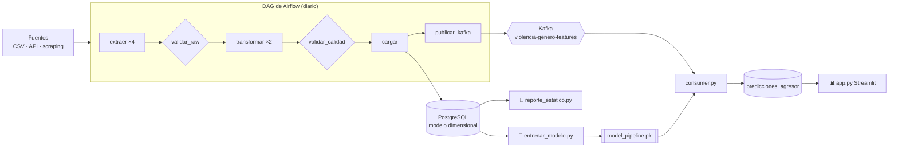
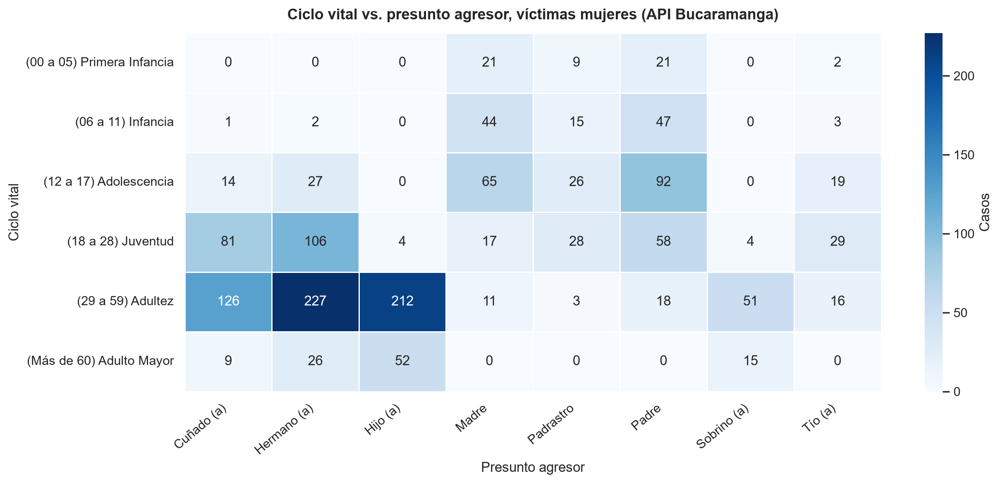
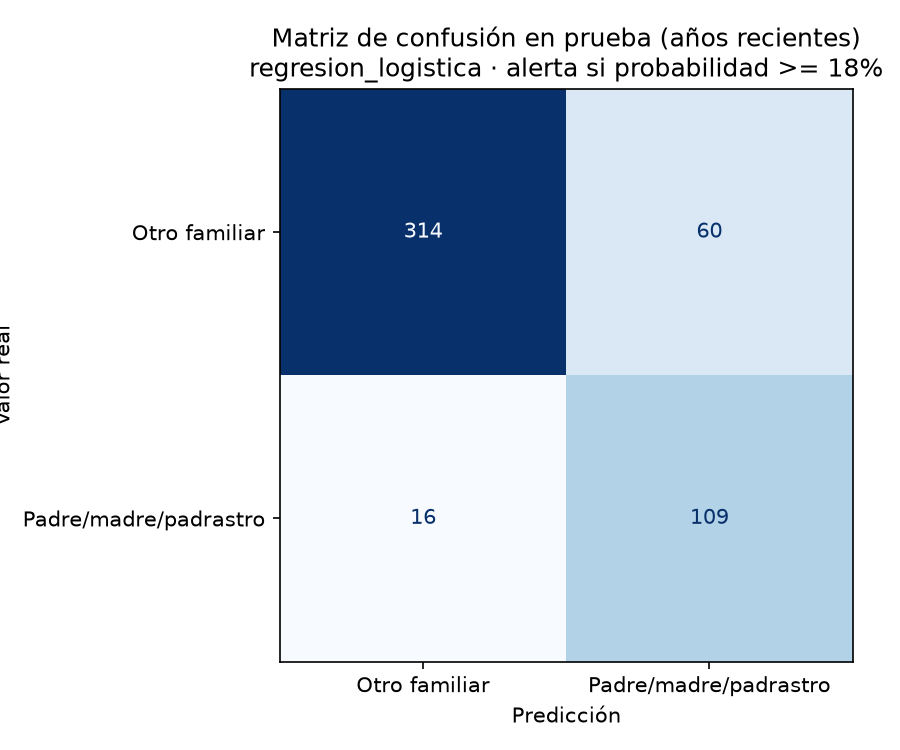
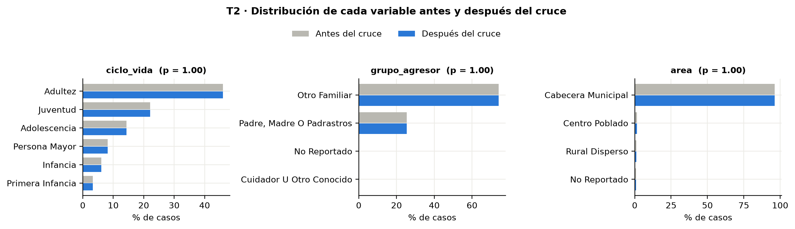
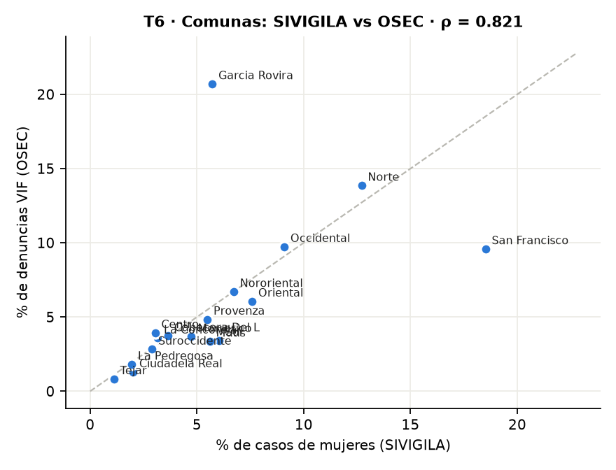

<div align="center">

# 🛡️ Violencia contra las mujeres en Bucaramanga
### Una arquitectura de datos analítica y operativa · ODS 5 Igualdad de Género


*Ingeniería de Datos e Inteligencia Artificial · Curso ETL (G51) · Proyecto · Entrega final*

**Leidy Johanna Alomia Zapata · Gustavo Coque · Carlos Cortes**

</div>

---

## 📑 Contenido

1. [Qué es este proyecto](#-qué-es-este-proyecto)
2. [Equipo y aportes](#-equipo-y-aportes)
3. [Novedades de la entrega final](#-novedades-de-la-entrega-final)
4. [Fuentes de datos](#-fuentes-de-datos)
5. [Arquitectura](#️-arquitectura)
6. [DAG de Airflow y calidad de datos](#-dag-de-airflow-y-calidad-de-datos)
7. [Modelo de machine learning](#-modelo-de-machine-learning)
8. [Streaming con Kafka](#-streaming-con-kafka)
9. [Reporte estático y dashboard en tiempo real](#-reporte-estático-y-dashboard-en-tiempo-real)
10. [Hallazgos principales](#-hallazgos-principales)
11. [Visualizaciones](#️-visualizaciones)
12. [Decisiones clave](#-decisiones-clave)
13. [Estructura del repositorio](#-estructura-del-repositorio)
14. [Instalación y ejecución](#-instalación-y-ejecución)
15. [Solución de problemas](#-solución-de-problemas)
16. [Historial de versiones](#️-historial-de-versiones)

> 📄 **Documento técnico completo:** [`Docs/Documento_tecnico.md`](Docs/Documento_tecnico.md)

---

## 🎯 Qué es este proyecto

Un pipeline ETL **orquestado, validado y con dos vías de consumo** sobre la misma arquitectura:

- **Vía analítica:** el Data Warehouse validado alimenta un **reporte estático** que responde *dónde, cómo y contra quién* ocurre la violencia contra las mujeres en Bucaramanga.
- **Vía operativa:** cada caso nuevo viaja por **Kafka**. Un **modelo de ML** estima la probabilidad de que el agresor sea **padre, madre o padrastro**, y un **dashboard en tiempo real** prioriza los casos que requieren activar la ruta de protección.

> **Pregunta del proyecto:** ¿Cómo se manifiesta la violencia contra las mujeres en Bucaramanga según el vínculo con el agresor, el ciclo de vida de la víctima, el tipo de violencia, la comuna y el contexto socioeconómico?

**ODS 5, meta 5.2:** eliminar todas las formas de violencia contra las mujeres y las niñas.

## 👥 Equipo y aportes

| Integrante | Rol | Aportes en la entrega final |
|---|---|---|
| **Leidy Johanna Alomia Zapata** | Data Engineer · ETL y orquestación | DAG de 10 tareas; respaldo en caché del scraping del OSEC; doble compuerta de Great Expectations (`validar_raw` + `validar_calidad`); limpieza de años y carga idempotente; vista de ML creada por el DAG; Docker/WSL y Kafka; productor inicial con regla anti-fuga |
| **Gustavo Coque** | Data Scientist · ML Engineer | Evaluación estadística del merge; modelo de clasificación (entrenamiento, evaluación y serialización); consumidor de Kafka con inferencia y tabla de predicciones; productor incremental con tabla de control |
| **Carlos Cortes** | Analytics · Visualización y documentación | Reporte analítico estático de una página; dashboard Streamlit en tiempo real (mapa de zonas del DANE, prioridades, monitor del flujo); documento técnico y README |

## 🆕 Novedades de la entrega final

| Segunda entrega | Entrega final |
|---|---|
| DAG de 8 tareas | **10 tareas**: se agregan `validar_raw` y `publicar_kafka` |
| Great Expectations antes de cargar (62 reglas) | **Doble compuerta**: antes de transformar y antes de cargar (**10 suites, 120 expectativas**) |
| Dashboard de Power BI | **Reporte estático en Python** + **dashboard Streamlit en tiempo real** |
| Sin modelo predictivo | **Modelo de ML** serializado (ROC-AUC 0.92 en años no vistos) |
| Sin streaming | **Kafka**: productor incremental → tópico → consumidor con inferencia |
| Merge sin evaluación estadística | **Evaluación estadística del merge** (χ², Spearman, V de Cramér) |
| Imputación de 0 en algunos vacíos | Los vacíos quedan como `NULL`: **no se inventan valores** |

## 📂 Fuentes de datos

| # | Fuente | Tipo | Rol |
|---|---|---|---|
| 1 | **SIVIGILA**, histórico de Bucaramanga (fuente de la primera entrega) | CSV | Casos atendidos en salud: agresor, tipo de violencia, edad y comuna |
| 2 | **ECV 2024, DANE** (dataset adicional) | CSV | Contexto socioeconómico (estrato, vivienda) |
| 3 | **API Medicina Legal**, datos.gov.co `ers2-kerr` (API pública) | API | Casos de violencia intrafamiliar: **fuente del modelo y del flujo de Kafka** |
| 4 | **OSEC**, Alcaldía de Bucaramanga | Web scraping + caché de respaldo | Denuncias por comuna |
| 5 | **DIVIPOLA / MGN, DANE** | API | Códigos, coordenadas y límites de zonas para el mapa |

Las fuentes se integran por **lugar** (código DANE, área, comuna) y **tiempo** (año, mes). **Se comparan, no se suman**, y la evaluación del merge lo respalda con datos.

## 🏗️ Arquitectura



El diagrama detallado está en el [documento técnico](Docs/Documento_tecnico.md#5-diagrama-de-arquitectura-actualizado).

## 🌀 DAG de Airflow y calidad de datos

```
extraer_sivigila ─┐
extraer_api ──────┤
extraer_vivienda ─┼─> validar_raw ─> transformar_violencia ─> transformar_fuentes_nuevas
extraer_scraping ─┘                                                    │
                        publicar_kafka <─ cargar_fuentes_nuevas <─ validar_calidad
```

- **Programación:** diario a las 6:00 a. m.; `max_active_runs=1`; las validaciones no se reintentan.
- **Compuerta 1 (`validar_raw`):** 5 suites sobre las tablas crudas, para que no se transformen esquemas rotos ni años inválidos.
- **Compuerta 2 (`validar_calidad`):** 5 suites sobre staging, para que solo datos válidos lleguen a las tablas analíticas.
- Cada resultado queda en `log_validaciones` y en `data/validaciones/*.json`. **Si una regla crítica falla, no se carga nada.**

## 🤖 Modelo de machine learning

| | |
|---|---|
| **Pregunta** | ¿Qué tan probable es que el agresor sea **padre, madre o padrastro** (vs. otro familiar)? |
| **Uso** | Priorizar casos para la ruta de protección (ICBF / Comisaría de Familia). **No identifica ni acusa a ninguna persona** |
| **Features** | `escenario`, `ciclo_vida`, `turno`, `dias_incapacidad`, `area`, `mes` (solo lo que se sabe **sin conocer al agresor**) |
| **Anti-fuga** | Nunca se usan `grupo_agresor`, `presunto_agresor`, `sexo_agresor`, `edad_agre`, `parentesco_vict`, `anio` ni ids |
| **División** | Temporal: entrenamiento 2015–2021, prueba 2022–2024 (años no vistos) |
| **Modelo** | Regresión logística en un `Pipeline` (imputación + one-hot con categorías raras agrupadas) |
| **Resultado** | ROC-AUC **0.92** (línea base 0.50); brecha entrenamiento-prueba ≈ 0; con el umbral de alerta 0.184: recall **87 %**, precisión 64 % |
| **Artefactos** | `models/model_pipeline.pkl`, `models/metadata_modelo.json`, `models/metricas_experimentos.csv` |
| **Limitación** | Se apoya sobre todo en la edad de la víctima; solo violencia intrafamiliar en Bucaramanga; debe reentrenarse periódicamente |

## 📡 Streaming con Kafka

- **Tópico:** `violencia-genero-features` (broker `localhost:9092`; desde Airflow, `kafka:29092`).
- **Productor incremental** (`etl/producer.py`): publica **solo los casos que no ha enviado**, usando la tabla de control `kafka_publicaciones`. Un caso nuevo de la API viaja **una sola vez**.
- **Consumidor** (`consumer.py`): valida el JSON, carga el `.pkl` **una vez**, calcula `predict_proba`, decide la alerta y guarda el resultado en `predicciones_agresor`.

```json
{"id_hecho_api": 1195, "id_caso_api": "2421", "timestamp_evento": "2026-11-23T04:11:49+00:00",
 "escenario": "VIVIENDA", "ciclo_vida": "INFANCIA", "turno": "NOCHE", "dias_incapacidad": "1 A 30",
 "area": "CABECERA MUNICIPAL", "mes": 7, "anio": 2023, "contexto": "...", "tipo_violencia": "...",
 "nombre_municipio": "BUCARAMANGA", "osec_denuncias_sexuales": null, "nivel_estrato": 3, "zona_vivienda": 1}
```

## 📊 Reporte estático y dashboard en tiempo real

| | Reporte estático (`reporte_estatico.py`) | Dashboard (`app.py`) |
|---|---|---|
| Lee | Modelo dimensional validado | Solo `predicciones_agresor` (salida del consumidor) |
| Se actualiza | Al regenerarlo (foto en un punto del tiempo) | Solo, con fragmentos de Streamlit (1 s a 5 min) |
| Contenido | 4 preguntas clave + 5 cifras | Alertas, prioridad y acción sugerida, mapa de zonas del DANE, lista para revisión manual, monitor del flujo |
| Salida | `Docs/reporte_estatico.html` (imprimible a PDF) | `http://localhost:8501` |

## 🔎 Hallazgos principales

- En víctimas **menores de edad**, el agresor es **padre, madre o padrastro en el 77 %** de los casos, frente al **10 %** en adultas.
- **Pareja o expareja** es el grupo de agresores más frecuente (33 %), pero los **familiares suman 42 %**. La violencia **sexual** representa el **26 %** de los casos.
- En 2024–2026, **San Francisco** concentra el 26.9 % de los casos atendidos en salud. **García Rovira** tiene cerca del 20 % de las denuncias del OSEC pero solo el 5.2 % de los casos atendidos: una **brecha** que hay que investigar.
- **Evaluación del merge:** el cruce no sesga los datos (χ² p = 1). En el tiempo, SIVIGILA y Medicina Legal no se mueven juntas (ρ = 0.10), pero en el territorio sí concuerdan (ρ = 0.82).

## 🖼️ Visualizaciones

### Modelo de datos (constelación de hechos)

<div align="center">


*Cuatro tablas de hechos (SIVIGILA, Medicina Legal, OSEC y ECV 2024) comparten las dimensiones de lugar y tiempo.*

</div>

Diagrama completo de la base de datos (zona cruda, staging, modelo y vistas): [`Docs/Graficas/base_de_datos_completa.png`](Docs/Graficas/base_de_datos_completa.png)

### Del análisis al modelo

| EDA: ciclo de vida vs. agresor (Medicina Legal) | Matriz de confusión del modelo (2022-2024) |
|---|---|
|  |  |
| El EDA mostró que en menores el agresor suele ser padre o madre: es la señal que aprende el modelo. | En años no vistos detecta 109 de 125 casos de padre/madre (recall 87 %). |

### Evaluación estadística del merge

| Distribuciones antes vs. después del cruce | Comunas: SIVIGILA vs. OSEC (ρ = 0.82) |
|---|---|
|  |  |

<!-- Capturas del sistema en ejecución: guardarlas en Docs/Graficas/ con estos nombres y quitar este comentario.
| DAG de la entrega final | Dashboard en tiempo real |
|---|---|
|  |  |
| **Mapa de zonas del DANE** | **Reporte estático** |
|  |  |
-->

Más resultados: [reporte estático](Docs/reporte_estatico.html) · [evaluación del merge](Docs/evaluacion_merge/evaluacion_merge.md) · [notebooks de EDA](Docs/notebook/).

## 🧭 Decisiones clave

| Decisión | Motivo |
|---|---|
| Doble compuerta de Great Expectations | Detener datos rotos antes de gastar cómputo y antes de tocar el modelo final |
| No imputar 0 ni valores por defecto | Un vacío significa "sin dato", no "cero casos" |
| Las fuentes se comparan, no se suman | Miden procesos distintos; la evaluación del merge lo demuestra (T5 vs. T6) |
| Objetivo binario (padre/madre vs. otro familiar) | Hay datos suficientes para esas dos clases y tiene un uso claro: proteger a menores |
| División temporal + validación cruzada solo en entrenamiento | Medir con datos "del futuro" y evitar fuga de información |
| Probabilidades calibradas + umbral de alerta | Porcentajes reales en el dashboard; recall alto para no dejar escapar casos |
| Productor incremental con tabla de control | Cada caso viaja una sola vez; volver a ejecutar el DAG no duplica eventos |
| Dashboard alimentado solo por el consumidor | Requisito del curso: el tiempo real lo impulsa Kafka, no consultas al Data Warehouse |
| Paleta apta para daltonismo + texturas | No depender solo del color |

## 📁 Estructura del repositorio

```
proyecto_etl_violencia_de_genero/
│   Readme.MD
│   requirements.txt               # dependencias en el PC: ML, Kafka, Streamlit, reporte
│   requirements-airflow.txt       # dependencias de la imagen de Airflow (Docker)
│   docker-compose.yaml            # Airflow 3.3.2 (CeleryExecutor)
│   docker-compose.postgres.yml    # Data Warehouse PostgreSQL en Docker
│   docker-compose.kafka.yml       # Kafka
│   Dockerfile  .env.example  .gitignore  LICENSE
│   consumer.py                    # consumidor de Kafka + inferencia
│   app.py                         # dashboard Streamlit en tiempo real
│   reporte_estatico.py            # reporte analítico de una página
│
├── dags/dag_violencia_genero.py   # DAG de 10 tareas
├── etl/                           # ingesta, scraping, transformación, homologación, validación,
│                                  # producer.py (incremental), descargar_zonas_dane.py
├── ml/entrenar_modelo.py          # entrenamiento y evaluación del modelo
├── models/                        # model_pipeline.pkl + metadata + métricas
├── analisis/evaluacion_merge.py   # pruebas estadísticas del merge
├── sql/                           # esquemas, carga y vistas
├── data/                          # fuentes, caché del OSEC, validaciones, geo/ (zonas DANE)
└── Docs/
    ├── Documento_tecnico.md
    ├── reporte_estatico.html
    ├── evaluacion_merge/           # resultados y gráficas del merge
    ├── Graficas/                   # diagramas, DAG, matriz de confusión
    └── notebook/                   # EDA de la primera y segunda entrega
```

## 🚀 Instalación y ejecución

### Requisitos
Docker Desktop · Python 3.12 · Git · (opcional) pgAdmin

### 1. Clonar y configurar variables
```bash
git clone https://github.com/Gca2004/Proyecto-ETL-violencia-de-genero.git
cd Proyecto-ETL-violencia-de-genero
copy .env.example .env        # Linux/Mac: cp .env.example .env
```
Completar `.env` con `DB_USER`, `DB_PASSWORD`, `DB_NAME=violencia_genero_db` y `DB_PORT=5432`. Este archivo **no se sube** a GitHub.

### 2. Levantar el Data Warehouse (PostgreSQL)
```bash
docker compose -f docker-compose.postgres.yml up -d
```
> ⚠️ Usa el puerto **5432**. Si tienes PostgreSQL instalado en Windows, detén ese servicio o usa la opción local (ver [Solución de problemas](#-solución-de-problemas)).

Crear las tablas, **en este orden**:
```bash
docker exec -i postgres_violencia_db psql -U postgres -d violencia_genero_db < sql/raw_violencia_genero.sql
docker exec -i postgres_violencia_db psql -U postgres -d violencia_genero_db < sql/esquema_violencia_genero.sql
docker exec -i postgres_violencia_db psql -U postgres -d violencia_genero_db < sql/raw_fuentes_entrega2.sql
docker exec -i postgres_violencia_db psql -U postgres -d violencia_genero_db < sql/esquema_entrega2.sql
```

### 3. Levantar Kafka y Airflow
```bash
docker compose -f docker-compose.kafka.yml up -d
docker compose up airflow-init
docker compose up -d --build
```

### 4. Ejecutar el DAG
Abrir `http://localhost:8080` (usuario y clave por defecto: `airflow` / `airflow`), activar `etl_violencia_genero_bucaramanga` y pulsar **Trigger**. Las 10 tareas deben quedar en verde. El DAG carga el modelo dimensional, crea la vista de ML y publica los casos nuevos en Kafka.

### 5. Preparar el entorno de Python (en el PC)
```bash
python -m venv .venv
.venv\Scripts\activate         # Linux/Mac: source .venv/bin/activate
pip install -r requirements.txt
```
> El modelo entrenado ya viene en `models/`. Para reentrenarlo: `python ml/entrenar_modelo.py`.

### 6. Vía operativa: consumidor + dashboard (dos terminales)
```bash
python consumer.py             # terminal 1: escucha Kafka y predice
streamlit run app.py           # terminal 2: dashboard en http://localhost:8501
```
Para el mapa con las zonas oficiales del DANE (una sola vez, necesita internet; los archivos ya vienen en `data/geo/`):
```bash
python etl/descargar_zonas_dane.py
```

**Demostración en vivo** (terminal 3, Windows CMD): reenviar 30 casos, uno por segundo.
```cmd
set DB_HOST=localhost
set KAFKA_BOOTSTRAP_SERVERS=localhost:9092
set KAFKA_REPUBLICAR=1
set KAFKA_STREAM_DELAY_SEC=1
set KAFKA_MAX_RECORDS=30
python etl\producer.py
```

### 7. Vía analítica: evaluación del merge + reporte estático
```bash
python analisis/evaluacion_merge.py   # Docs/evaluacion_merge/
python reporte_estatico.py            # Docs/reporte_estatico.html
```

### Consultas útiles
```sql
-- Última validación de cada suite de Great Expectations
WITH u AS (SELECT suite, MAX(fecha_ejecucion) f FROM log_validaciones GROUP BY suite)
SELECT l.suite, COUNT(*) reglas, COUNT(*) FILTER (WHERE exito) cumplidas
FROM log_validaciones l JOIN u ON u.suite = l.suite AND u.f = l.fecha_ejecucion GROUP BY l.suite;

-- Casos publicados en Kafka y predicciones generadas
SELECT COUNT(*) FROM kafka_publicaciones;
SELECT COUNT(*) AS eventos, SUM(alerta::int) AS alertas FROM predicciones_agresor;
```

## 🧯 Solución de problemas

| Síntoma | Causa | Solución |
|---|---|---|
| El scheduler o el worker se reinician y el DAG queda "En cola" | Airflow no encuentra `postgres_violencia_db` | Levantar primero `docker-compose.postgres.yml` (paso 2) |
| El contenedor de PostgreSQL no arranca | El puerto 5432 está ocupado por PostgreSQL de Windows | Detener ese servicio (`services.msc`) o usar la opción local |
| Quiero usar mi PostgreSQL local | `docker-compose.yaml` apunta al contenedor | Crear `docker-compose.override.yml` (ignorado por Git) con `DB_HOST: host.docker.internal` en los servicios de Airflow |
| `publicar_kafka` falla con "relation does not exist" | Falta el esquema | Ejecutar los `.sql` del paso 2 y volver a correr el DAG |
| El dashboard no muestra datos nuevos | No hay casos nuevos que publicar | Usar la demostración en vivo del paso 6 |
| `.pkl` no carga | Versión distinta de scikit-learn | Instalar la versión de `metadata_modelo.json` (1.9.1) |

## 🗂️ Historial de versiones

| Versión | Entrega | Contenido |
|---|---|---|
| `v1.0` | Primera | SIVIGILA, EDA, esquema estrella en PostgreSQL |
| `v2.0` | Segunda | API Medicina Legal, ECV 2024, scraping OSEC, Airflow, Great Expectations, constelación de hechos, Power BI |
| `v3.0` | **Final** | Doble compuerta GE, evaluación del merge, modelo de ML, Kafka (productor incremental + consumidor), reporte estático y dashboard Streamlit |

```bash
git tag -a v3.0 -m "Entrega final: ML, Kafka, reporte estatico y dashboard en tiempo real"
git push origin v3.0
```

---

<div align="center">

Proyecto académico · Licencia MIT · Datos abiertos de SIVIGILA, Medicina Legal (datos.gov.co), DANE y Alcaldía de Bucaramanga

</div>